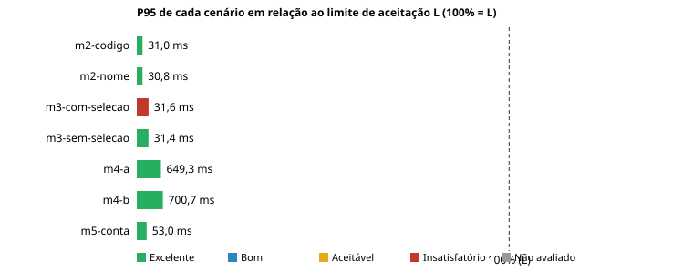

# Análise de G2 — rodada `20261115-2128`

## Resultado por cenário

| Métrica | Cenário | Medidas | Sucessos | Erros | Expirações | P95 (ms) | L (ms) | Classificação | Observação |
|---|---|---|---|---|---|---|---|---|---|
| M2 | m2-codigo | 30 | 30 | 0 | 0 | 31,0 | 2000 | Excelente (3) |  |
| M2 | m2-nome | 30 | 30 | 0 | 0 | 30,8 | 2000 | Excelente (3) |  |
| M3 | m3-com-selecao | 30 | 10 | 20 | 0 | 31,6 | 1000 | Não avaliado | 20 tentativa(s) falharam na preparação, antes do clique (defeito do roteiro, regra 1): preparação: estado não limpo (turmas marcadas = 0, esperado 1) |
| M3 | m3-sem-selecao | 30 | 30 | 0 | 0 | 31,4 | 1000 | Excelente (3) |  |
| M4 | m4-a | 30 | 30 | 0 | 0 | 649,3 | 10000 | Excelente (3) |  |
| M4 | m4-b | 30 | 30 | 0 | 0 | 700,7 | 10000 | Excelente (3) |  |
| M5 | m5-conta | 30 | 30 | 0 | 0 | 53,0 | 2000 | Excelente (3) |  |

## Consolidação por métrica e hipóteses

| Métrica | Nota da métrica (menor cenário) | Cobertura | Hipótese | Questão |
|---|---|---|---|---|
| M2 | Excelente (3) | completa | H2 sustentada | Q2 |
| M3 | sem nota consolidada | parcial | H3 inconclusiva | Q3 |
| M4 | Excelente (3) | completa | H4 sustentada | Q4 |
| M5 | Excelente (3) | completa | H5 sustentada | Q5 |

As hipóteses valem só para as condições avaliadas (reprodução local, `commit` `3d399e7`, massa de referência). Não demonstram desempenho em produção nem são testes de significância (Fase 2, seção 4.3, regra 5).
