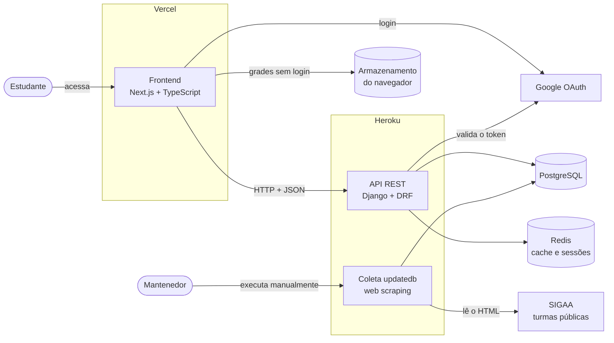
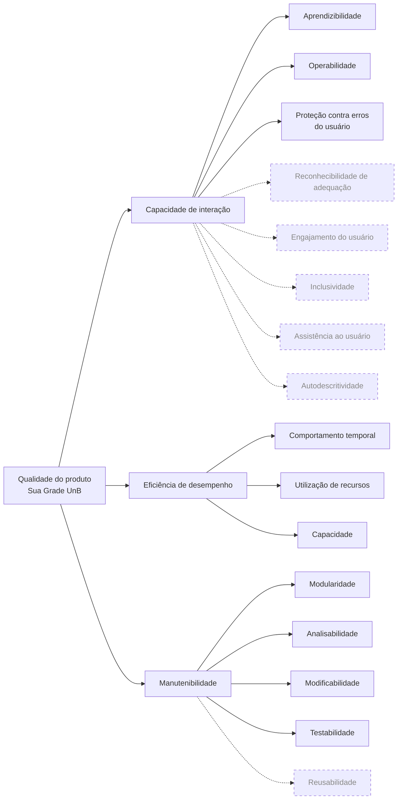

# Fase 1 — Estabelecer os requisitos da avaliação

<!--
Referência: ISO/IEC 25040, atividade 1. Critérios da Fase 1 (Moodle) indicados em cada seção.
Lembrete: nenhuma imagem sem texto alternativo — use .
-->

## 1. Propósito da avaliação e uso pretendido

### 1.1 Contexto

O [Sua Grade UnB](https://suagradeunb.com.br/) é uma aplicação web que ajuda estudantes da
Universidade de Brasília a montar a grade horária do semestre. O estudante busca disciplinas
por nome ou código, seleciona as que deseja cursar e o sistema gera combinações de turmas sem
conflito de horário, que podem ser salvas na conta do usuário ou no próprio navegador. Os dados de turmas são obtidos por *web scraping* das turmas do SIGAA.

O sistema foi desenvolvido no segundo semestre de 2023 por seis estudantes na disciplina de Métodos de Desenvolvimento de Software (MDS) e é open source.

Repositório disponível em: [unb-mds/2023-2-SuaGradeUnB](https://github.com/unb-mds/2023-2-SuaGradeUnB).

Depois da disciplina, o projeto continuou com manutenções eventuais:

**Tabela 1 — Atividade no repositório do Sua Grade UnB**

| Ano | Commits na branch principal | Observação |
|-----|-----------------------------|------------|
| 2023 | 475 | Desenvolvimento durante a disciplina |
| 2024 | 33 | Novas funcionalidades pontuais (ex.: calculadora de IRA) |
| 2025 | 5 | Majoritariamente atualizações automáticas de dependências |
| 2026 | 2 | Correção do *web scraping* após mudança no SIGAA, feita por contribuidor externo |

Fonte: Histórico do repositório (consulta em 16/10/2026).

O que motiva a avaliação do produto:

1. **Uso recorrente e concentrado:** o sistema é usado a cada período de matrícula, quando muitos estudantes acessam ao mesmo tempo.
2. **Manutenção por voluntários:** a equipe idealizadora do projeto já concluiu a disciplina, e correções recentes vieram de propostas feitas por contribuidores externos.
3. **Dependência de uma fonte externa instável:** mudanças no SIGAA quebram a coleta de dados, como ocorreu em 2026 e o webscrapping que teve de ser refatorado. O que exige que o código seja fácil de entender e modificar por quem não o escreveu.

Até onde verificamos, o produto nunca passou por uma avaliação sistemática de qualidade.

### 1.2 Propósito

Avaliar a qualidade do Sua Grade UnB, em operação, para **identificar e priorizar os problemas de qualidade que mais afetam os estudantes no período de matrícula e a continuidade da manutenção do sistema por voluntários**, produzindo recomendações de melhoria para os mantenedores e embasando a ação de melhoria que a equipe executará na Fase 4.

### 1.3 Uso pretendido: decisões apoiadas

Esperamos que os resultados ajudem nas decisões da Tabela 2.

**Tabela 2 — Decisões apoiadas pela avaliação**

| Decisão | Quem decide |
|---------|-------------|
| D1 — Quais problemas corrigir primeiro antes do próximo período de matrícula | Mantenedores do Sua Grade UnB |
| D2 — Qual ação de melhoria executar na Fase 4 | Nossa equipe |
| D3 — Por qual parte do código começar a contribuir | Contribuidores externos e futuros mantenedores |

Os resultados serão publicados nesta GitPage e no artigo da disciplina. As recomendações destinadas aos mantenedores (D1) serão registradas como *issues* no repositório do Sua Grade UnB.

## 2. Requisitante e partes interessadas

### 2.1 Requisitante

A avaliação trata-se de uma **avaliação
independente**, conduzida em contexto acadêmico. O **requisitante** é a equipe Elizabeth
Friedman, que também atua como **avaliadora**, sob orientação da disciplina de Qualidade de Software. Os
**principais destinatários** dos resultados são os mantenedores do Sua Grade UnB, que tomam a
decisão D1 da [Tabela 2](#13-uso-pretendido-decisoes-apoiadas).

Consequências da avaliação:

- A equipe não tem acesso a logs e nem banco de dados de produção.
- As medições usarão o site público, o código-fonte e a reprodução local do sistema.

### 2.2 Mapa de partes interessadas

**Tabela 3 — Partes interessadas, necessidades e influência na avaliação**

| Parte interessada | Papel | Necessidades e expectativas | Critério de sucesso da avaliação | Influência na avaliação |
|-------------------|-------|-----------------------------|----------------------------------|-------------------------|
| Equipe Elizabeth Friedman | Requisitante e avaliadora | Avaliação viável em cerca de seis semanas, com dados base de evidências para a ação de melhoria | Todas as métricas coletadas conforme o plano da Fase 3; ação de melhoria justificada por resultados medidos (D2) | Limita escopo e profundidade ao prazo e aos recursos disponíveis |
| Profa. Cristiane Ramos | Orientadora e avaliadora do processo | Aplicação correta do processo SQuaRE, do GQM e do PSM/CID, com rastreabilidade dos dados | Resultados rastreáveis do dado bruto ao julgamento; entregas nos prazos | Define restrições de método: processo ISO/IEC 25040, três a quatro características, GQM, prazos das entregas |
| Mantenedores do Sua Grade UnB | Desenvolvedores, mantenedores e operadores | Manter o sistema funcionando a cada semestre e saber o que priorizar com tempo limitado | Receber problemas localizados e recomendações que possam virar *issues* (D1) | Direciona a avaliação para o código e a arquitetura, motivando a característica **Manutenibilidade** e recomendações entregues no formato de *issues* |
| Contribuidores externos | Desenvolvedores eventuais | Entender o código e contribuir | Diagnóstico de quais módulos são mais difíceis de analisar, modificar e testar (D3) | Reforça **Manutenibilidade**, com foco em analisabilidade, modificabilidade e testabilidade |
| Estudantes da UnB | Usuários finais | Montar a grade durante a matrícula, sem conflitos de horário, inclusive no celular | Identificação dos obstáculos no fluxo principal e dos tempos de resposta que podem prejudicar o uso | Motiva **Usabilidade** e **Eficiência**. As tarefas avaliadas seguirão o fluxo principal: buscar disciplina, selecionar turmas, gerar grade e salvar |
| Universidade de Brasília (SIGAA) | Fonte dos dados | Que a coleta não sobrecarregue o SIGAA e que os estudantes não sejam induzidos a erro por dados desatualizados ou incompletos | Avaliação feita sem gerar carga sobre o SIGAA | Restringe o método: não faremos coletas repetidas no SIGAA |

As características citadas na última coluna são as selecionadas pela equipe; a justificativa e
a priorização entre elas estão na [Seção 5](#5-selecao-e-priorizacao-das-caracteristicas).

## 3. Tipo de produto e descrição do software

<!--
Critério 3: classificar o tipo de produto; descrever módulos, interfaces, dependências e restrições.
Para nota máxima: diagrama de contexto/arquitetura e implicações para a avaliação (o que dá / não dá para medir agora).
-->

### 3.1 Tipo de produto

O Sua Grade UnB é uma **aplicação web cliente-servidor em operação**, de acesso público e
gratuito. Ela é formada por duas aplicações separadas: um *frontend* acessado pelo navegador e uma
API REST que concentra as regras de negócio e os dados. Por ser um produto já em uso, e não em
desenvolvimento, avaliamos o produto pronto: o site público e o código-fonte do *commit* `3d399e7`
(15/02/2026), o último da branch principal na data da consulta.

### 3.2 Componentes

**Tabela 4 — Componentes do Sua Grade UnB**

| Componente | Tecnologias | Responsabilidade | Onde roda em produção |
|------------|-------------|------------------|-----------------------|
| *Frontend* (`web/`) | Next.js 14, React 18, TypeScript, Tailwind CSS | Telas de busca de disciplinas, seleção de turmas, visualização das grades geradas e exportação em PDF; guarda grades no armazenamento do navegador | Vercel |
| API (`api/`) | Python 3.11, Django 5.1, Django REST Framework | Busca de disciplinas, geração de grades, cadastro e login, grades salvas na conta | Heroku |
| Banco de dados | PostgreSQL | Departamentos, disciplinas, turmas, usuários e grades salvas | Não identificado publicamente |
| *Cache* | Redis | *Cache* de 12 h, sessões e controle de quais departamentos já foram atualizados | Não identificado publicamente |
| Coleta de dados (`updatedb`) | Requests, BeautifulSoup | *Web scraping* das turmas do SIGAA, executado manualmente por um mantenedor | Servidor da API |

Fonte: código-fonte e documentação do repositório; a hospedagem do *frontend* e da API foi
identificada pelos cabeçalhos HTTP das respostas (consulta em 17/10/2026).

A API é dividida em três módulos Django: `api` (disciplinas, turmas e grades), `users` (cadastro,
login com Google e *tokens* JWT) e `utils` (coleta do SIGAA, gerador de grades e acesso ao banco).
O código tem cerca de 5,4 mil linhas de Python na API e 2,6 mil linhas de TypeScript no *frontend*.

### 3.3 Interfaces

A comunicação entre o *frontend* e a API é feita por HTTP com JSON. A API publica sua própria
documentação em Swagger.

**Tabela 5 — Rotas da API**

| Rota | Método | Função | Exige login |
|------|--------|--------|-------------|
| `/courses/` | GET | Busca disciplinas por nome, código ou professor | Não |
| `/courses/year-period/` | GET | Informa os períodos disponíveis para busca | Não |
| `/courses/schedules/generate/` | POST | Gera as grades sem conflito de horário (devolve as 5 melhores) | Não |
| `/courses/schedules/` | GET / POST | Lista e salva grades na conta | Sim |
| `/courses/schedules/<id>/` | DELETE | Apaga uma grade salva | Sim |
| `/users/register/<oauth2>/` | POST | Cadastro e login com a conta Google | Não |
| `/users/login/` | POST | Renova o *token* de acesso | Não |
| `/users/logout/` | POST | Encerra a sessão | Sim |

Fonte: `api/core/urls.py`, `api/api/urls.py` e `api/users/urls.py` do repositório.

### 3.4 Dependências externas e restrições

- **SIGAA:** é a única fonte dos dados de turmas. A coleta lê o HTML da página pública de turmas, então qualquer mudança no SIGAA pode quebrá-la. A coleta não é automática, depende de um mantenedor rodar o comando no servidor.
- **Google OAuth:** é o único meio de login. Sem login, o estudante ainda gera grades e pode guardá-las no navegador, mas não na conta.
- **Hospedagem:** a API roda no Heroku, que é pago, e o *frontend* na Vercel.
- **Limites do código:** a geração aceita até 11 disciplinas com até 4 turmas cada e devolve as 5 melhores grades e a busca devolve até 15 disciplinas.
- **Testes:** a API tem 108 testes automatizados, executados no GitHub Actions com relatório de cobertura e o *frontend* não tem testes.

### 3.5 Diagrama de contexto e arquitetura

**Figura 1 — Contexto e arquitetura do Sua Grade UnB**

Fonte: elaborado pela equipe a partir do código-fonte e da documentação do repositório.

### 3.6 Reprodução local e implicações para a avaliação

Em 17/10/2026 rodamos o sistema localmente com `docker compose`, seguindo o README do projeto. Os
quatro serviços (API, *frontend*, PostgreSQL e Redis) subiram sem erros. Para não fazer
requisições ao SIGAA, carregamos no banco o HTML de exemplo do SIGAA que já vem no repositório
(`api/utils/mock/sigaa.html`), com um departamento, 14 disciplinas e 43 turmas. O login foi testado
com o *token* de teste previsto no próprio código, sem conta Google.

Com isso conseguimos executar o fluxo principal pela API (buscar disciplina, gerar grade, salvar,
listar e apagar grade) e abrir o *frontend*. Os 108 testes automatizados da API também rodaram e
passaram, com relatório de cobertura.

**Tabela 8 — O que dá e o que não dá para medir**

| Objeto | Temos acesso? | Implicação para a avaliação |
|--------|---------------|-----------------------------|
| Código-fonte completo | Sim | Manutenibilidade pode ser medida por análise estática e pelos testes |
| Testes automatizados da API | Sim, rodam localmente | Testabilidade pode ser medida pela cobertura e pelo resultado dos testes |
| Site público | Sim | Capacidade de interação pode ser avaliada com usuários no site real; tempo de carregamento das páginas também |
| API pública | Sim, com poucas requisições | Tempo de resposta em produção será medido com poucas requisições espaçadas |
| Reprodução local | Sim, com dados de exemplo | Capacidade e utilização de recursos só serão medidas localmente; os valores não representam o servidor de produção |
| Logs, métricas e banco de produção | Não | Não dá para medir erros reais, uso de CPU e memória no Heroku nem o número de acessos |
| Carga real do período de matrícula | Não | Não faremos teste de carga em produção, porque a hospedagem é paga pelos mantenedores |
| Login real com Google na reprodução local | Só criando um projeto no Google Cloud | Usamos o *token* de teste do código para as rotas que exigem login |

Fonte: elaborado a partir da reprodução local.

Duas limitações valem para os resultados. Os dados de exemplo são poucos e de um único
departamento, então medições de desempenho locais podem não refletir o volume real de turmas. E
localmente os servidores rodam em modo de desenvolvimento, diferente da configuração de produção.

## 4. Modelo de qualidade

<!--
Critério 4: modelo escolhido (ISO/IEC 25010), adaptações JUSTIFICADAS por contexto e stakeholders,
diagrama com ligações às subcaracterísticas.
-->

### 4.1 Modelo de referência

Usamos o modelo de qualidade de produto da **ISO/IEC 25010:2023**, da série SQuaRE (ISO/IEC 25000),
e seguimos o processo de avaliação da ISO/IEC 25040. A versão de 2023 renomeou duas das
características que escolhemos e mudou parte das subcaracterísticas. Neste trabalho usamos os nomes
de 2023; a Tabela 6 mostra a correspondência com a versão de 2011.

**Tabela 6 — Correspondência entre as versões da ISO/IEC 25010**

| ISO/IEC 25010:2011 | ISO/IEC 25010:2023 | O que mudou nas subcaracterísticas |
|--------------------|--------------------|------------------------------------|
| Usabilidade | Capacidade de interação | Estética da interface virou Engajamento do usuário; Acessibilidade foi dividida em Inclusividade e Assistência ao usuário; Autodescritividade foi incluída |
| Eficiência de desempenho | Eficiência de desempenho | Sem mudanças |
| Manutenibilidade | Manutenibilidade | Sem mudanças |

Fonte: ISO/IEC 25010:2011 e ISO/IEC 25010:2023.

O termo "usabilidade" passou a fazer parte do modelo de qualidade em uso, descrito na
ISO/IEC 25019:2023. Como avaliamos a qualidade do produto, e não a qualidade em uso, a
característica correspondente aqui é a Capacidade de interação.

### 4.2 Adaptação do modelo

O modelo completo tem nove características. Mantivemos as três selecionadas na
[Seção 5](#5-selecao-e-priorizacao-das-caracteristicas) e, dentro delas, só as subcaracterísticas
ligadas às partes interessadas da [Tabela 3](#22-mapa-de-partes-interessadas) e às decisões da
[Tabela 2](#13-uso-pretendido-decisoes-apoiadas).

**Tabela 7 — Subcaracterísticas incluídas e excluídas**

| Característica | Subcaracterística | Situação | Justificativa |
|----------------|-------------------|----------|---------------|
| Capacidade de interação | Aprendizibilidade | Incluída | O estudante usa o sistema poucas vezes por semestre, e calouros o usam pela primeira vez na matrícula |
| | Operabilidade | Incluída | O fluxo principal tem várias etapas (buscar, selecionar, gerar, salvar) e é usado também no celular |
| | Proteção contra erros do usuário | Incluída | Há relatos de usuários sobre grades geradas acima do limite de créditos (*issue* #238) |
| | Reconhecibilidade de adequação | Excluída | O sistema tem um único propósito, já indicado no nome e na tela inicial |
| | Engajamento do usuário | Excluída | O uso é pontual e com objetivo definido; a aparência não pesa nas decisões D1 a D3 |
| | Inclusividade | Excluída | Fora do escopo desta avaliação por limite de prazo |
| | Assistência ao usuário | Excluída | Fora do escopo desta avaliação por limite de prazo |
| | Autodescritividade | Excluída | Sobreposta à aprendizibilidade nas tarefas que vamos observar |
| Eficiência de desempenho | Comportamento temporal | Incluída | Busca e geração de grade precisam responder rápido no pico da matrícula |
| | Utilização de recursos | Incluída | A geração combina todas as turmas escolhidas, o que pode chegar a milhões de combinações |
| | Capacidade | Incluída | O uso se concentra na matrícula, e a API não limita o número de requisições; será medida só na reprodução local |
| Manutenibilidade | Modularidade | Incluída | Uma mudança no SIGAA deveria afetar só o módulo de coleta |
| | Analisabilidade | Incluída | Contribuidores externos precisam localizar a causa de falhas em código que não escreveram (D3) |
| | Modificabilidade | Incluída | A correção da coleta em 2026 mostra que o código precisa ser alterado sem quebrar o resto |
| | Testabilidade | Incluída | A API tem testes automatizados, mas o *frontend* não tem nenhum |
| | Reusabilidade | Excluída | Nenhuma das decisões D1 a D3 depende de reaproveitar componentes em outros sistemas |

Fonte: elaborado pela equipe a partir da ISO/IEC 25010:2023.

### 4.3 Diagrama do modelo adaptado

**Figura 2 — Modelo de qualidade adaptado da ISO/IEC 25010:2023**

Fonte: elaborado pela equipe a partir da ISO/IEC 25010:2023.

As linhas tracejadas indicam as subcaracterísticas excluídas, com a justificativa na Tabela 7.

## 5. Seleção e priorização das características

-->

### 5.1 Características selecionadas

Selecionamos três características da ISO/IEC 25010:2023: **Manutenibilidade**, **Capacidade de
interação** (Usabilidade, na versão de antiga) e **Eficiência de desempenho**. As subcaracterísticas de cada uma estão no [modelo de qualidade](#4-modelo-de-qualidade).

Cada característica responde a uma parte interessada da [Tabela 3](#22-mapa-de-partes-interessadas):
Manutenibilidade aos mantenedores e contribuidores externos, Capacidade de interação e Eficiência
de desempenho aos estudantes. As demais características do modelo ficaram de fora pelos motivos da
Tabela 9.

**Tabela 9 — Características não selecionadas (Baseadas na ISO 25010:2023)**

| Característica | Por que ficou de fora |
|----------------|-----------------------|
| Adequação funcional | O sistema está em uso há três anos e as funções principais funcionam bem|
| Confiabilidade | As falhas conhecidas vêm da coleta do SIGAA, cuja causa (acoplamento ao HTML de outro sistema) é coberta pela Manutenibilidade |
| Segurança | O sistema guarda poucos dados pessoais (nome, e-mail e grades salvas) |
| Compatibilidade | O sistema tem poucas integrações (Google e SIGAA) e não divide ambiente com outros produtos |
| Flexibilidade | A implantação é fixa (Vercel e Heroku) e não há demanda por levar o sistema a outros ambientes |
| Proteção (*safety*) | O uso do sistema não envolve risco físico, ambiental ou financeiro |

### 5.2 Método de priorização

Usamos uma matriz de pontuação ponderada com três critérios. Cada característica recebe uma nota
de 1 (baixo) a 3 (alto) em cada critério.

- **Impacto (peso 3):** quanto um problema na característica afeta as partes interessadas e as
  decisões D1 a D3 da [Tabela 2](#13-uso-pretendido-decisoes-apoiadas).
- **Risco (peso 2):** quanto há evidência de que existam problemas hoje (issues abertas, histórico do repositório ...).
- **Viabilidade (peso 1):** quanto conseguimos medir a característica com o acesso que temos.

Impacto tem o maior peso porque é ele que liga a avaliação ao seu propósito.

**Tabela 10 — Matriz de priorização**

| Característica | Impacto (×3) | Risco (×2) | Viabilidade (×1) | Total | Prioridade |
|----------------|:------------:|:----------:|:----------------:|:-----:|:----------:|
| Manutenibilidade | 3 | 3 | 3 | 18 | 1ª |
| Capacidade de interação | 3 | 2 | 2 | 15 | 2ª |
| Eficiência de desempenho | 2 | 2 | 1 | 11 | 3ª |

Fonte: elaborado pela equipe.

Justificativa das notas:

- **Manutenibilidade.**
    - *Impacto 3:* o sistema depende de voluntários e a continuidade dele depende de o código
      ser fácil de entender e alterar (D1 e D3).
    - *Risco 3:* a coleta já quebrou com uma mudança no SIGAA, a atividade no repositório caiu
      de 475 *commits* em 2023 para 2 em 2026 ([Tabela 1](#11-contexto)) e as correções recentes
      vieram de contribuidores externos.
    - *Viabilidade 3:* temos o código completo e os testes rodam localmente.
- **Capacidade de interação.**
    - *Impacto 3:* afeta todos os estudantes que usam o sistema na matrícula.
    - *Risco 2:* há relatos de usuários sobre grades acima do limite de créditos (*issue* #238) e
      horários exibidos de forma incompleta (*issue* #248), mas o fluxo principal funciona.
    - *Viabilidade 2:* o site é público, mas a avaliação depende convidar uma amostra de estudantes para avaliar.
- **Eficiência de desempenho.**
    - *Impacto 2:* lentidão incomoda, mas não impede a utilização. O que realmente pode afetar é a disponibilidade em momentos de pico, mas a aplicação está em servidores em nuvem.
    - *Risco 2:* a geração combina todas as turmas escolhidas e a API não limita o número de
      requisições, mas o código limita a 11 disciplinas e não há relatos de lentidão.
    - *Viabilidade 1:* não temos acesso às métricas de produção e só podemos medir carga na
      reprodução local.

A prioridade define como a equipe divide o esforço nas Fases 3 e 4: a Manutenibilidade recebe a
análise mais detalhada e é a primeira candidata à ação de melhoria (D2).

### 5.3 Trade-offs

- **Eficiência × Capacidade de interação:** o limite de 11 disciplinas e 5 grades devolvidas protege
  o servidor, mas restringe o estudante. Recomendações que ampliem esses limites precisam ser
  avaliadas também pelo custo de processamento.
- **Eficiência × Manutenibilidade:** otimizações como *cache* adicional ou um algoritmo de geração
  mais elaborado podem deixar o código mais difícil de entender. Na Fase 4, será avaliado o trade-off em caso de sugestão de melhoria.
- **Validade × viabilidade:** medir carga localmente é viável, mas os valores não representam o
  servidor real. Aceitamos essa limitação, registrada na [Seção 6](#6-escopo-profundidade-e-objetos-de-avaliacao).

## 6. Escopo, profundidade e objetos de avaliação

### 6.1 Objetos de avaliação

**Tabela 11 — Objetos de avaliação**

| Objeto | Versão ou estado | Características avaliadas |
|--------|------------------|---------------------------|
| Código-fonte da API (`api/`) e do *frontend* (`web/`) | *Commit* `3d399e7`, de 15/02/2026 | Manutenibilidade |
| Testes automatizados da API | *Commit* `3d399e7` | Manutenibilidade (testabilidade) |
| Site público ([suagradeunb.com.br](https://suagradeunb.com.br/)) | Versão em produção na data da coleta | Capacidade de interação; Eficiência de desempenho (carregamento das páginas) |
| API pública | Versão em produção na data da coleta | Eficiência de desempenho (tempo de resposta) |
| Reprodução local com `docker compose` | *Commit* `3d399e7` | Eficiência de desempenho (capacidade e utilização de recursos) |

As tarefas avaliadas seguem o fluxo principal do sistema: buscar disciplina, selecionar turmas,
gerar a grade e salvá-la.

### 6.2 O que fica fora do escopo

**Tabela 12 — Itens fora do escopo**

| Item | Motivo |
|------|--------|
| Características não selecionadas | Ver [Tabela 9](#51-caracteristicas-selecionadas) |
| Funções secundárias (exportar grade, página de informações, perfil) | Não fazem parte do fluxo principal usado na matrícula |
| Tela de login do Google | É de outro fornecedor; avaliamos só o que acontece no Sua Grade UnB antes e depois dela |
| Infraestrutura de produção (Heroku, Vercel, banco de dados) | Não temos acesso |
| Teste de carga em produção | A hospedagem é paga pelos mantenedores e uma carga poderia tirar o sistema do ar |

### 6.3 Profundidade

- **Manutenibilidade:** análise estática automatizada de todo o código da API e do *frontend*,
  execução dos testes com relatório de cobertura e inspeção manual dos módulos de coleta do SIGAA
  e de geração de grades, que são os mais críticos e os que mais mudaram.
- **Capacidade de interação:** teste com cerca de cinco estudantes de graduação da UnB, que
  executarão as tarefas do fluxo principal no site real. Serão registrados o tempo, os erros e a
  conclusão de cada tarefa, e ao final os participantes responderão ao questionário SUS (*System
  Usability Scale*) (BROOKE, 1996). A meta é ao menos cinco participantes  para encontrar possíveis problemas de usabilidade.Os participantes assinarão um termo de consentimento
  e serão identificados apenas por código (P1, P2...).
- **Eficiência de desempenho:** tempo de carregamento do site público e tempo de resposta da API
  pública com poucas requisições espaçadas; capacidade e utilização de recursos medidas apenas na
  reprodução local.

### 6.4 Limites de validade dos resultados

- Os resultados valem para o *commit* `3d399e7` e para o site no estado em que estiver na data da
  coleta. Mudanças posteriores no sistema podem alterá-los.
- As medições de desempenho em produção serão feitas fora do período de matrícula e não mostram o
  comportamento no pico de acessos.
- As medições locais usam poucos dados e servidores em modo de desenvolvimento, e por isso não
  representam o desempenho em produção.

## 7. Objetivos de Desenvolvimento Sustentável (ODS)

### 7.1 ODS e metas relacionados

O Sua Grade UnB se relaciona com o **ODS 4 — Educação de qualidade**, em duas metas. Usamos a
redação das metas adaptada ao Brasil e os indicadores oficiais publicados pelo IPEA (IPEA, [2019]).

**Tabela 13 — Metas do ODS 4 relacionadas ao Sua Grade UnB**

| Meta (versão Brasil) | Indicador oficial | Pertinência ao software |
|----------------------|-------------------|-------------------------|
| **4.3** — "Até 2030, assegurar a equidade (gênero, raça, renda, território e outros) de acesso e permanência à educação profissional e à educação superior de qualidade, de forma gratuita ou a preços acessíveis." | 4.3.1 — "Taxa de participação de jovens e adultos na educação formal e não formal, nos últimos 12 meses, por sexo" | O sistema é gratuito e ajuda o estudante a montar uma grade viável, sem conflitos de horário, na matrícula. Uma ferramenta difícil de usar ou lenta no pico de acessos prejudica justamente quem tem menos apoio para planejar o semestre |
| **4.4** — "Até 2030, aumentar substancialmente o número de jovens e adultos que tenham as competências necessárias, sobretudo técnicas e profissionais, para o emprego, trabalho decente e empreendedorismo." | 4.4.1 — "Proporção de jovens e adultos com habilidades em tecnologias de informação e comunicação (TIC), por tipo de habilidade" | O projeto nasceu numa disciplina, é aberto e é mantido por estudantes. Um código fácil de entender e modificar permite que novos estudantes aprendam contribuindo com um sistema real em uso |

Fonte: IPEA ([2019]).

### 7.2 Indicadores da avaliação

Os indicadores oficiais são estatísticas nacionais e não serão medidos por esta avaliação. A
Tabela 14 mostra os indicadores da nossa avaliação que se relacionam com cada meta. As métricas
exatas serão definidas no GQM da [Fase 2](fase-2.md).

**Tabela 14 — Indicadores da avaliação relacionados às metas**

| Meta | Indicador da avaliação | Característica |
|------|------------------------|----------------|
| 4.3 | Taxa de conclusão das tarefas do fluxo principal pelos estudantes no teste de usabilidade | Capacidade de interação |
| 4.3 | Pontuação SUS média dos participantes | Capacidade de interação |
| 4.3 | Tempo de resposta da busca e da geração de grade | Eficiência de desempenho |
| 4.4 | Métricas de analisabilidade, modificabilidade e testabilidade do código (por exemplo, complexidade e cobertura de testes) | Manutenibilidade |

---

Próxima etapa: [Fase 2 — Especificação da avaliação](fase-2.md).
