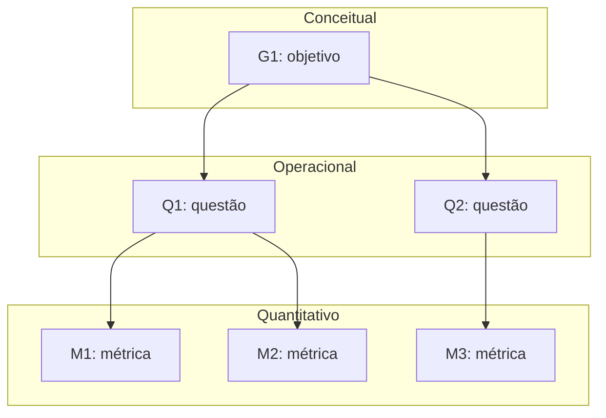

# Fase 2 — Especificar a avaliação

<!--
Referência: ISO/IEC 25040, atividade 2; método GQM (Basili).
F2-C11: deixar EXPLÍCITO como cada objetivo deriva das características e stakeholders da Fase 1.
-->

Os objetivos de medição abaixo derivam do propósito, das decisões apoiadas e das
necessidades das partes interessadas documentados na [Fase 1](fase-1.md).

A seleção e a priorização das características na [Seção 5 da Fase 1](fase-1.md#5-selecao-e-priorizacao-das-caracteristicas)
ainda estão em elaboração. Estes objetivos são iniciais e deverão ser revisados após
a consolidação dessa seção. O objetivo G3 e suas questões incluem capacidade de
interação conforme o recorte solicitado para esta etapa. Essa inclusão ainda precisa
ser conciliada com a orientação de não incluir usabilidade registrada na Seção 5 da
Fase 1; suas quatro subcaracterísticas são uma proposta inicial, não uma seleção já
consolidada naquela fase.

## 1. Objetivos de medição (nível conceitual)

<!--
F2-C1: usar o template GQM completo para cada objetivo.
-->

Cada objetivo segue os cinco elementos do template GQM: **analisar** (objeto),
**com o propósito de** (finalidade), **com respeito a** (foco de qualidade),
**do ponto de vista de** (parte interessada) e **no contexto de** (condições e
restrições da avaliação). A tabela a seguir resume sua derivação da Fase 1;
as referências detalhadas aparecem após cada objetivo.

| Objetivo | Necessidade de origem na Fase 1 | Parte interessada e foco de qualidade | Decisões apoiadas |
|----------|--------------------------------|--------------------------------------|-------------------|
| G1 — Manutenibilidade | Manutenção por voluntários e adaptação da coleta às mudanças no SIGAA ([Seção 1.1](fase-1.md#11-contexto)); continuidade da manutenção ([Seção 1.2](fase-1.md#12-proposito)). | Mantenedores e contribuidores externos: compreender, modificar e testar o código ([Seção 2.2, Tabela 3](fase-1.md#22-mapa-de-partes-interessadas)). | D1, D2 e D3 ([Seção 1.3](fase-1.md#13-uso-pretendido-decisoes-apoiadas)). |
| G2 — Eficiência de desempenho | Uso concentrado na matrícula ([Seção 1.1](fase-1.md#11-contexto)) e identificação de tempos de resposta que prejudicam a montagem da grade ([Seção 2.2, Tabela 3](fase-1.md#22-mapa-de-partes-interessadas)). | Estudantes da UnB: tempo de resposta ao buscar disciplinas, selecionar turmas, gerar e salvar grades ([Seção 2.2, Tabela 3](fase-1.md#22-mapa-de-partes-interessadas)). | D1 e D2 ([Seção 1.3](fase-1.md#13-uso-pretendido-decisoes-apoiadas)). |
| G3 — Capacidade de interação | Identificação de obstáculos à montagem da grade, inclusive no celular ([Seção 2.2, Tabela 3](fase-1.md#22-mapa-de-partes-interessadas)). | Estudantes da UnB: aprender o fluxo, operar os controles, evitar erros e compreender o estado da interface. Recorte proposto nesta fase. | D1 e D2 ([Seção 1.3](fase-1.md#13-uso-pretendido-decisoes-apoiadas)). |

### G1 — Manutenibilidade

| Elemento | Descrição |
|----------|-----------|
| Analisar | O código-fonte do Sua Grade UnB, com foco nos componentes de coleta de dados do SIGAA e de busca de disciplinas, seleção de turmas, geração e salvamento de grades. |
| Com o propósito de | Avaliar a facilidade de manutenção e identificar os componentes que devem receber melhorias prioritárias para viabilizar correções e contribuições de voluntários. |
| Com respeito a | Manutenibilidade, com foco em analisabilidade, modificabilidade e testabilidade. |
| Do ponto de vista de | Mantenedores e contribuidores externos do Sua Grade UnB. |
| No contexto de | Uma avaliação acadêmica independente conduzida pela equipe Elizabeth Friedman, em cerca de seis semanas, de uma aplicação web em operação e mantida por voluntários, utilizando o repositório público e a reprodução local, sem acesso a logs ou ao banco de dados de produção e sem coletas repetidas no SIGAA. |

**Origem na Fase 1:** a [Seção 1.1](fase-1.md#11-contexto) registra a manutenção
por voluntários e a necessidade de adaptar a coleta de dados após mudanças no SIGAA.
O [propósito da avaliação](fase-1.md#12-proposito) inclui a continuidade da manutenção.
Na [Seção 2.2, Tabela 3](fase-1.md#22-mapa-de-partes-interessadas), as necessidades dos
mantenedores e dos contribuidores externos motivam explicitamente a manutenibilidade
e o foco em analisabilidade, modificabilidade e testabilidade. O objetivo apoia as
decisões **D1** (priorizar correções), **D2** (escolher a melhoria da Fase 4) e **D3**
(identificar por onde começar a contribuir), definidas na [Seção 1.3](fase-1.md#13-uso-pretendido-decisoes-apoiadas).

### G2 — Eficiência de desempenho

| Elemento | Descrição |
|----------|-----------|
| Analisar | O desempenho do Sua Grade UnB no fluxo de buscar disciplinas, selecionar turmas, gerar e salvar grades. |
| Com o propósito de | Avaliar o desempenho do fluxo principal e identificar operações cuja lentidão possa prejudicar o uso e deva ser priorizada nas melhorias. |
| Com respeito a | Eficiência de desempenho, com foco no comportamento temporal das operações do fluxo principal. |
| Do ponto de vista de | Estudantes da UnB que utilizam o sistema para montar a grade no período de matrícula. |
| No contexto de | Uma avaliação acadêmica independente conduzida pela equipe Elizabeth Friedman, em cerca de seis semanas, por observações no site público e medições em reprodução local sob condições documentadas, sem acesso a logs ou ao banco de dados de produção e sem gerar carga sobre o SIGAA. Os resultados ficam limitados às condições avaliadas e não demonstram, por si só, o desempenho em picos reais de matrícula. |

**Origem na Fase 1:** a [Seção 1.1](fase-1.md#11-contexto) identifica o uso recorrente
e concentrado no período de matrícula. O [propósito da avaliação](fase-1.md#12-proposito)
prevê identificar problemas que afetam os estudantes nesse período. Na
[Seção 2.2, Tabela 3](fase-1.md#22-mapa-de-partes-interessadas), os estudantes motivam
explicitamente a característica de eficiência e a avaliação dos tempos de resposta
no fluxo principal. A mesma tabela estabelece a restrição de não gerar carga sobre
o SIGAA. O objetivo apoia as decisões **D1** (priorizar correções) e **D2** (escolher a
melhoria da Fase 4), definidas na [Seção 1.3](fase-1.md#13-uso-pretendido-decisoes-apoiadas).

### G3 — Capacidade de interação (Usabilidade)

| Elemento | Descrição |
|----------|-----------|
| Analisar | A interface do Sua Grade UnB no fluxo de buscar disciplinas, selecionar turmas, gerar e salvar grades, em computador e celular. |
| Com o propósito de | Identificar obstáculos à interação e orientar melhorias que facilitem a montagem da grade pelos estudantes. |
| Com respeito a | Capacidade de interação, com foco proposto em aprendizagem, operabilidade, proteção contra erros do usuário e autodescrição. |
| Do ponto de vista de | Estudantes da UnB, incluindo aqueles que utilizam o sistema pela primeira vez. |
| No contexto de | Uma avaliação acadêmica independente conduzida pela equipe Elizabeth Friedman, em cerca de seis semanas, com tarefas representativas do período de matrícula, dados de referência e condições documentadas de uso em computador e celular, sem acesso a dados de produção e sem coletas repetidas no SIGAA. |

**Origem na Fase 1:** a [Seção 2.2, Tabela 3](fase-1.md#22-mapa-de-partes-interessadas)
registra a necessidade dos estudantes de montar a grade, inclusive no celular, e
identificar obstáculos no fluxo principal. Essa necessidade fundamenta G3 e apoia
as decisões **D1** e **D2** da [Seção 1.3](fase-1.md#13-uso-pretendido-decisoes-apoiadas).
A escolha das quatro subcaracterísticas é uma proposta desta fase e depende de
conciliação com a seleção de características da Fase 1.

## 2. Questões e hipóteses (nível operacional)

<!--
F2-C2: questões que cobrem os atributos do foco de qualidade (não métricas disfarçadas de pergunta).
F2-C3: uma hipótese clara para CADA questão.
-->

### 2.1 Manutenibilidade — G1

| ID | Questão | Hipótese | Objetivo |
|----|---------|----------|----------|
| Q1 | | H1: | G1 |

### 2.2 Eficiência de desempenho — G2

As questões abaixo cobrem **comportamento temporal**, a subcaracterística selecionada
no [objetivo G2](#g2-eficiencia-de-desempenho), nas quatro operações do fluxo principal
identificadas na [Seção 2.2 da Fase 1](fase-1.md#22-mapa-de-partes-interessadas).
Utilização de recursos e capacidade não integram o recorte atual de G2.

As hipóteses são expectativas a verificar, não resultados da avaliação. Os limites
de tempo aceitáveis por operação e a regra para confirmar ou refutar cada hipótese
estão definidos na Seção 4, para aplicação na coleta. As condições de execução,
os dados utilizados e a repetição das tarefas serão especificados no plano da
[Fase 3](fase-3.md), permitindo comparar os resultados sob condições documentadas.

| ID | Subcaracterística | Questão | Hipótese | Objetivo |
|----|-------------------|---------|----------|----------|
| Q2 | Comportamento temporal | A busca de disciplinas apresenta os resultados em tempo aceitável para o estudante dar continuidade à montagem da grade? | H2: O tempo entre solicitar uma busca por nome ou código e visualizar seus resultados atende ao limite de aceitação definido para a busca, nas condições avaliadas. | G2 |
| Q3 | Comportamento temporal | A seleção de turmas atualiza a interface em tempo aceitável para o estudante continuar selecionando as opções desejadas? | H3: O tempo entre selecionar uma turma e visualizar a atualização correspondente na interface atende ao limite de aceitação definido para a seleção, nas condições avaliadas. | G2 |
| Q4 | Comportamento temporal | A geração de combinações de turmas sem conflito apresenta as grades em tempo aceitável nos cenários de montagem avaliados? | H4: O tempo entre solicitar a geração e visualizar as combinações de grades atende ao limite de aceitação definido para a geração em cada cenário avaliado. | G2 |
| Q5 | Comportamento temporal | O salvamento de uma grade fornece retorno em tempo aceitável para o estudante concluir a tarefa? | H5: O tempo entre solicitar o salvamento e visualizar sua confirmação atende ao limite de aceitação definido para o salvamento, nas modalidades avaliadas de conta do usuário e armazenamento no navegador. | G2 |

### 2.3 Capacidade de interação (Usabilidade) — G3

Adota-se para este recorte a característica **capacidade de interação** da
[ISO/IEC 25010:2023](https://www.iso.org/standard/78176.html), mantendo
“Usabilidade” no título para correspondência com a solicitação da atividade.
Propõem-se quatro subcaracterísticas ligadas aos obstáculos no fluxo principal
identificados como preocupação na [Seção 2.2 da Fase 1](fase-1.md#22-mapa-de-partes-interessadas):
**aprendizagem** (*learnability*), **operabilidade** (*operability*),
**proteção contra erros do usuário** (*user error protection*) e
**autodescrição** (*self-descriptiveness*).

O recorte cobre o primeiro uso, o controle das ações, a prevenção de erros e a
compreensão da interface. As demais subcaracterísticas não são cobertas por estas
questões; os resultados não deverão ser generalizados para toda a característica.

| ID | Subcaracterística | Questão | Hipótese | Objetivo |
|----|-------------------|---------|----------|----------|
| Q6 | Aprendizagem | Um estudante que utiliza o Sua Grade UnB pela primeira vez consegue aprender a buscar disciplinas, selecionar turmas, gerar e salvar uma grade com as orientações oferecidas pelo próprio sistema? | H6: Após uma primeira exploração, os estudantes sem experiência prévia conseguem concluir o fluxo principal com as orientações do sistema, sem instruções adicionais do avaliador, dentro do tempo de aprendizagem estabelecido previamente no protocolo. | G3 |
| Q7 | Operabilidade | O estudante consegue controlar a seleção de disciplinas e turmas e revisar suas escolhas durante a montagem da grade, tanto no computador quanto no celular? | H7: Nos dois tipos de dispositivo, os estudantes conseguem selecionar, remover e alterar suas escolhas pelos controles da interface, sem bloqueios de navegação ou controles inacessíveis que impeçam concluir as tarefas previstas. | G3 |
| Q8 | Proteção contra erros do usuário | A interface protege o estudante de ações equivocadas que possam causar perda involuntária da grade em edição ou de uma grade salva? | H8: Nos cenários de ações com risco de perda definidos previamente, a interface impede a perda involuntária por meio de prevenção, confirmação antes da ação ou possibilidade de desfazê-la e recuperar a grade. | G3 |
| Q9 | Autodescrição | O estudante compreende, a partir dos rótulos, mensagens e indicadores da interface, o estado atual da montagem e a próxima ação disponível? | H9: Nos pontos de verificação do fluxo, os estudantes identificam corretamente as turmas selecionadas, distinguem a geração em andamento da geração concluída e reconhecem se o salvamento foi concluído, com base nas informações da interface e sem explicação do avaliador. | G3 |

As hipóteses são expectativas a verificar. Para H6, o protocolo deverá separar a
exploração inicial da execução observada e fixar o tempo de aprendizagem. Para H7,
deverá especificar dispositivos, tamanhos de tela e tarefas equivalentes. Para H8,
deverá identificar as ações de risco realmente disponíveis na versão avaliada,
usando apenas grades e contas de teste. Para H9, deverá definir os pontos de
verificação e as respostas esperadas, distinguindo compreender o estado da
interface de apenas concluir a tarefa.

As métricas de H6–H9 estão definidas na Seção 3.3. Seus limites de aceitação e suas
regras de julgamento ainda precisam ser especificados na Seção 4, antes da coleta. Participantes, roteiros
e condições de execução deverão ser documentados na [Fase 3](fase-3.md). Os limites
temporais de G2 não serão usados automaticamente para julgar G3.

## 3. Métricas (nível quantitativo)

<!--
F2-C4 e premissa 2: para cada métrica documentar definição, procedimento de cálculo (fórmula),
fonte dos dados, procedimento de coleta e critérios de interpretação.
Fórmulas em LaTeX: $ X = \frac{A}{B} $ em linha, ou $$ ... $$ em bloco.
-->

### 3.1 Convenções de medição de eficiência de desempenho

As métricas **M2 a M5** respondem, respectivamente, às questões **Q2 a Q5** do
objetivo **G2**, cobrindo comportamento temporal. A métrica M1 permanece reservada
à questão de manutenibilidade, ainda em elaboração.

Para cada operação e cenário, executar duas tentativas de aquecimento, registradas
e excluídas do cálculo, seguidas de **30 tentativas medidas**, sequenciais e sem
concorrência. Esse tamanho de amostra é uma escolha operacional inicial da equipe;
não representa uma garantia estatística sobre o uso em produção. Restaurar o estado
inicial antes de cada tentativa e manter os mesmos dados, navegador, equipamento,
rede e política de cache dentro de cada cenário. Documentar essas condições na
Fase 3. Separar os resultados por cenário e ambiente, sem misturar medições locais
com observações do site público. A coleta repetida será realizada em reprodução
local com dados previamente disponíveis, sem acionar a coleta do SIGAA.

Medir o intervalo entre a ação do usuário e o resultado visível na interface,
incluindo processamento, comunicação e atualização visual. Usar um mesmo relógio
monotônico no navegador e registrar os eventos em um roteiro automatizado ou em
uma instrumentação local reproduzível. Tempos de requisições de rede isoladas não
substituem esse intervalo. Os seletores e sinais de conclusão serão confirmados
na preparação do roteiro na Fase 3, conforme o comportamento real da aplicação.

Para cada tentativa concluída com sucesso:

$$
t_i = t_{\mathrm{fim},i} - t_{\mathrm{início},i}
$$

Os tempos são expressos em **milissegundos (ms)**. Ordenando os tempos válidos de
forma crescente, calcular o percentil 95 pelo método do posto mais próximo:

$$
P_{95}(t) = t_{(\lceil 0{,}95n \rceil)}
$$

Nessa fórmula, $n$ é o número de tentativas medidas concluídas com sucesso e
$t_{(k)}$ é o tempo na posição $k$ da série ordenada. Com 30 sucessos, utiliza-se
o 29º tempo. Com nenhum sucesso, o percentil é **não calculável**.

Registrar as 30 tentativas, incluindo erros e expiração do tempo de espera, sem
substituí-los por novas tentativas ou tratá-los como tempos iguais a zero. O tempo
máximo de espera por operação será fixado na Fase 3, antes da coleta, e deverá ser
superior ao respectivo limite de aceitação. Publicar o número de sucessos, erros e
expirações junto ao percentil; este descreve apenas as tentativas bem-sucedidas.
Ocorrências de falha impedem confirmar a hipótese apenas com base em um percentil
baixo e devem ser consideradas na regra de julgamento da Seção 4.

Guardar os dados brutos em CSV com: métrica, cenário, ambiente, versão do sistema,
data, número da tentativa, indicação de aquecimento, instante inicial, instante
final, duração, estado (sucesso, erro ou expiração) e referência à evidência.
Registrar a configuração do ambiente e a massa de dados junto ao arquivo.

Para cada métrica, **menor é melhor**. O resultado atende ao requisito temporal
quando $M_j \leq L_j$, em que $L_j$ é o limite de aceitação da operação e do
cenário, em ms. Os valores de $L_2$ a $L_5$, sua justificativa e os níveis de
pontuação estão definidos na Seção 4. A confirmação das hipóteses também depende
das regras de completude e tratamento de falhas dessa seção.

### M1 — Manutenibilidade (a definir)

| Campo | Descrição |
|-------|-----------|
| Questão respondida | Q1 |
| Definição | |
| Fórmula | $ X = \frac{A}{B} $ |
| Fonte dos dados | |
| Procedimento de coleta | |
| Interpretação | |

### M2 — Tempo de resposta da busca de disciplinas (P95)

| Campo | Descrição |
|-------|-----------|
| Questão respondida | Q2 — hipótese H2; objetivo G2. |
| Definição | Percentil 95 do tempo entre a ação que solicita a busca e a exibição dos resultados correspondentes ao termo informado, com a interface pronta para interação. |
| Fórmula | $M_2 = P_{95}(t_{\mathrm{busca}})$, em ms, conforme a Seção 3.1. |
| Fonte dos dados | Registros de eventos do navegador na reprodução local, arquivo CSV das tentativas e evidências da atualização dos resultados. |
| Procedimento de coleta | Preparar cenários separados para busca por nome e por código, com termos e resultados esperados fixos. Iniciar a marcação na ação que dispara a busca; se houver busca automática, usar o último evento de entrada do termo, incluindo eventual espera programada pela aplicação. Encerrar quando os resultados correspondentes estiverem visíveis e utilizáveis, sem confundir resultados anteriores com os da nova busca. Executar o protocolo da Seção 3.1 para cada cenário. |
| Interpretação | Comparar cada cenário com $L_2$. Um resultado acima do limite indica demora na busca sob as condições medidas. Interpretar junto aos erros e expirações; o resultado não demonstra desempenho em picos de matrícula. |

### M3 — Tempo de atualização após seleção de turma (P95)

| Campo | Descrição |
|-------|-----------|
| Questão respondida | Q3 — hipótese H3; objetivo G2. |
| Definição | Percentil 95 do tempo entre selecionar uma turma e visualizar a atualização completa do estado de seleção na interface. |
| Fórmula | $M_3 = P_{95}(t_{\mathrm{seleção}})$, em ms, conforme a Seção 3.1. |
| Fonte dos dados | Registros de eventos de seleção e atualização visual do navegador na reprodução local, arquivo CSV e evidências do estado selecionado. |
| Procedimento de coleta | Fixar a disciplina, a turma e as seleções anteriores de cada cenário. Iniciar a marcação na ação de selecionar a turma e encerrar quando os indicadores visuais correspondentes refletirem o novo estado e a interface permitir continuar a tarefa. Restaurar as seleções iniciais entre tentativas, fora do intervalo medido. Executar o protocolo da Seção 3.1. |
| Interpretação | Comparar cada cenário com $L_3$. Um resultado acima do limite indica atraso na atualização após a seleção, nas condições medidas. Uma atualização ausente ou incorreta é registrada como erro, não como resposta rápida. |

### M4 — Tempo de geração de grades (P95)

| Campo | Descrição |
|-------|-----------|
| Questão respondida | Q4 — hipótese H4; objetivo G2. |
| Definição | Percentil 95 do tempo entre solicitar a geração e concluir a apresentação das combinações de grades previstas pelo fluxo da aplicação para o conjunto selecionado. |
| Fórmula | $M_4 = P_{95}(t_{\mathrm{geração}})$, em ms, conforme a Seção 3.1. |
| Fonte dos dados | Registros de acionamento e conclusão da geração no navegador da reprodução local, massa de dados de disciplinas e turmas, arquivo CSV e evidências das grades apresentadas. |
| Procedimento de coleta | Preparar conjuntos fixos de disciplinas e turmas com combinações válidas conhecidas. Documentar por cenário as quantidades de disciplinas, turmas candidatas e combinações válidas esperadas. Iniciar a marcação na solicitação de geração e encerrar quando o processamento e a apresentação previstos pelo fluxo estiverem concluídos e o estudante puder consultar as grades. Não encerrar apenas ao aparecer um indicador de carregamento ou um resultado parcial. Executar o protocolo da Seção 3.1 e calcular o percentil separadamente para cada conjunto. |
| Interpretação | Comparar cada cenário com $L_4$. Tempos acima do limite indicam demora na geração para aquele conjunto. Comparações entre conjuntos ajudam a identificar sensibilidade ao volume de combinações, mas não estabelecem a capacidade máxima do sistema. Resultados incompatíveis com a massa de referência são registrados como erro. |

### M5 — Tempo de retorno do salvamento de grade (P95)

| Campo | Descrição |
|-------|-----------|
| Questão respondida | Q5 — hipótese H5; objetivo G2. |
| Definição | Percentil 95 do tempo entre solicitar o salvamento de uma grade e visualizar o sinal de conclusão bem-sucedida fornecido pela interface. |
| Fórmula | $M_5 = P_{95}(t_{\mathrm{salvamento}})$, em ms, conforme a Seção 3.1. |
| Fonte dos dados | Registros de eventos de salvamento e de sua confirmação no navegador da reprodução local, arquivo CSV e evidências da recuperação da grade salva. |
| Procedimento de coleta | Preparar uma grade fixa e cenários separados para salvamento na conta de teste e no navegador, conforme as modalidades disponíveis. Concluir autenticação e preparação antes da marcação. Iniciar ao solicitar o salvamento e encerrar na confirmação visual. Depois do intervalo medido, verificar se a grade pode ser recuperada; uma confirmação sem persistência verificada conta como erro. Restaurar o estado inicial entre tentativas e executar o protocolo da Seção 3.1. Se uma modalidade não puder ser reproduzida, registrar a limitação e não lhe atribuir resultado. |
| Interpretação | Comparar separadamente cada modalidade com $L_5$. Tempos acima do limite indicam demora no retorno do salvamento. Um retorno rápido sem persistência não confirma H5. O tempo de autenticação e o de recuperação usado na verificação não integram esta métrica. |

### 3.2 Verificação de viabilidade da coleta

Esta verificação distingue **viabilidade documental** (há uma ferramenta e um caminho
de acesso identificados), **ferramenta testada** (o recurso executou uma operação
básica) e **coleta validada** (o roteiro foi executado no ambiente
da avaliação e produziu dados e evidências). A consulta ao repositório e a inspeção
do ambiente foram feitas em **18/10/2026**. Nenhuma das métricas abaixo teve ainda
sua coleta validada por execução ponta a ponta.

O [README do Sua Grade UnB](https://github.com/unb-mds/2023-2-SuaGradeUnB#readme)
documenta instalação, execução por Docker Compose, frontend em `localhost:3000`,
backend em `localhost:8000` e configuração de Google OAuth para login. Isso fornece
um caminho de reprodução, mas não comprova que a aplicação esteja operacional no
ambiente da equipe. O procedimento de atualização do banco descrito no README
aciona o SIGAA e não será usado na coleta; a massa local deverá ser preparada e
validada previamente, sem essa dependência.

| Métrica | Ferramenta e evidência prevista | Acesso necessário | Ambiente e dependências | Situação e condição para validar |
|---------|--------------------------------|-------------------|-------------------------|----------------------------------|
| M1 — Manutenibilidade | A definir após a formulação de Q1 e da métrica. | O código é público, mas a fonte específica depende da definição da métrica. | A definir. | **Não verificável no estado atual:** falta especificar a métrica; não presumir que ferramentas de análise estática sejam suficientes. |
| M2 — Busca | Playwright com Chromium, marcações temporais no navegador, CSV e captura dos resultados. | Código público e API local com disciplinas e turmas de referência; confirmar no piloto se o fluxo exige autenticação. | Frontend, backend e banco locais populados; cenários fixos de nome e código. | **Viável sob condições:** executar uma busca de cada tipo, verificar o resultado esperado e demonstrar a captura dos dois instantes e do CSV. |
| M3 — Seleção | Playwright com Chromium, marcações temporais e captura da atualização visual. | Acesso ao fluxo de disciplinas e turmas; confirmar no piloto os requisitos de sessão. | Mesma aplicação local de M2, com turma conhecida e estado inicial restaurável. | **Viável sob condições:** demonstrar que uma seleção produz o estado esperado e que o roteiro distingue a atualização completa de um estado anterior. |
| M4 — Geração | Playwright com Chromium, marcações temporais, CSV e evidência das combinações geradas. | Acesso ao gerador e a uma massa local com combinações válidas previamente conferidas. | Aplicação local e conjuntos fixos de disciplinas e turmas, com resultados de referência. | **Viável sob condições:** gerar um conjunto conhecido e verificar que o sinal de término representa a conclusão prevista em M4, incluindo a conferência dos resultados. |
| M5 — Salvamento no navegador | Playwright com Chromium, marcações temporais, CSV e evidência de recuperação da grade. | Acesso à modalidade de armazenamento no navegador, cuja disponibilidade precisa ser confirmada na versão avaliada. | Aplicação local, contexto de navegador preservado durante a verificação e grade fixa. | **Viável sob condições:** confirmar a modalidade, identificar seu sinal visual de conclusão e recuperar a grade após recarregar a página. Se o sinal não existir, revisar M5 antes da coleta. |
| M5 — Salvamento na conta | Playwright com Chromium, sessão de teste autenticada, marcações temporais, CSV e evidência de recuperação. | Conta de teste e configuração local de OAuth conforme o projeto; sem credenciais ou banco de produção. | Frontend, backend e banco locais, autenticação funcional e persistência configurada. | **Viável sob condições adicionais:** concluir login antes da medição, salvar e recuperar a grade após recarregar. Sem autenticação funcional, registrar esta modalidade como não coletada; não generalizar o resultado do navegador para a conta. |
| M6 — Aprendizagem | Navegador, cronômetro, questionário de experiência prévia e ficha CSV; captura de tela para conferir a grade e sua recuperação. | Estudantes sem uso prévio, com autorização para observação; acesso ao fluxo e ao salvamento na modalidade escolhida. | Computador e celular reais, distribuídos entre participantes distintos; aplicação com dados de referência, limites de exploração e aprendizagem fixos e estado inicial restaurável. | **Viável sob condições:** demonstrar em piloto separado a marcação dos dois períodos, a anotação de ajuda e a verificação do resultado salvo. Ferramenta de captura testada em computador; participantes, celular e fluxo completo ainda não verificados. |
| M7 — Operabilidade | Navegador, ficha de observação em CSV e capturas dos estados anterior e posterior; Playwright pode apoiar a restauração do estado. | Participantes e acesso aos controles de seleção, remoção e alteração; conta de teste apenas se exigida pelo fluxo. | Computador e celular reais, com dimensões e navegador registrados; tarefas equivalentes e massa de dados fixa. | **Viável sob condições:** executar no piloto uma tarefa de cada tipo em cada dispositivo, conferir o estado final e registrar sucesso, insucesso e ajuda. Emulação de tela não substitui a sessão em celular nem a observação de participantes. |
| M8 — Proteção contra perda | Navegador, roteiro de inspeção executado pelo avaliador, CSV e capturas; Playwright pode repetir ações e conferir estados. | Grades descartáveis e inventário de ações de risco; sessão de teste para operações na conta, sem usar grades pessoais. | Aplicação isolada com estado restaurável, computador e celular; persistência local e autenticação funcional para as respectivas modalidades. | **Viável sob condições:** inventariar ações existentes e executar um cenário por mecanismo disponível, comprovando prevenção, cancelamento ou recuperação. Não requer participantes. Modalidade sem acesso fica não avaliada; ausência de proteção em ação acessível é um resultado da métrica. |
| M9 — Autodescrição | Navegador, roteiro de perguntas neutras, gabarito de estados, ficha CSV e captura da interface no momento da resposta. | Participantes autorizados e acesso aos estados reais de seleção, geração e salvamento. | Computador e celular reais; dados de referência e método validado para observar estados transitórios sem acrescentar pistas à interface. | **Viável sob condições:** apresentar cada ponto de verificação no piloto, guardar a resposta e conferir a classificação pelo gabarito. O estado de geração em andamento ainda precisa ter sua observabilidade demonstrada; um roteiro automatizado não substitui as respostas dos estudantes. |

A escolha do Playwright se apoia em sua [documentação de automação de navegadores](https://playwright.dev/docs/intro).
Para as marcações, usar `performance.now()` no mesmo contexto de página, cujo
[relógio monotônico é documentado pela MDN](https://developer.mozilla.org/en-US/docs/Web/API/Performance/now).
Os sinais de conclusão visual precisam ser implementados e conferidos no piloto;
observar somente uma alteração no DOM ou uma resposta HTTP não comprova que a
operação terminou e está visível. Registrar o mecanismo adotado e sua limitação
de precisão na Fase 3.

**Resultado da inspeção do ambiente de trabalho:** Node `24.19.0`, npm `11.17.0`
e Python `3.12.3` responderam aos comandos de versão. Playwright `1.62.1` e
Chromium `151.0.7922.34`, encontrados no cache do usuário, foram executados:
uma página HTML de teste recebeu um clique, exibiu o estado esperado e produziu
uma captura de tela. A consulta a `performance.now()` também respondeu. A primeira
inicialização foi bloqueada pelo sandbox (`Operation not permitted`); o teste
teve sucesso após execução autorizada fora dele. Esse teste confirma operações
básicas da ferramenta, não a precisão da medição nem o roteiro do Sua Grade UnB.

Uma abertura da [página pública](https://suagradeunb.com.br/) no mesmo navegador
retornou HTTP **200**, título **Sua Grade UnB**, as opções **Continuar com o Google**
e **Continuar como anônimo**, sem exceções JavaScript de página registradas durante
essa abertura. Não houve login nem avanço para as tarefas. Assim, o acesso à tela
inicial foi demonstrado, mas a disponibilidade das disciplinas, do fluxo anônimo
e das modalidades de salvamento ainda não foi confirmada.

`docker compose version` e `docker ps` falharam informando que o Docker não está
disponível nesta distribuição WSL. A reprodução local, a massa de dados e o login
de teste ainda não foram demonstrados neste ambiente. Não foram realizadas sessões
com participantes nem testes em celular real. Esses resultados descrevem a máquina
inspecionada, não todas as máquinas da equipe.

**Registro resumido das verificações de 18/10/2026:**

| Verificação executada | Resultado observado | Alcance da evidência |
|-----------------------|---------------------|----------------------|
| `node --version`, `npm --version`, `python3 --version` | `v24.19.0`, `11.17.0`, `Python 3.12.3`. | Executáveis disponíveis; não confirma dependências do produto. |
| Inicialização do Chromium por Playwright, `setContent`, clique e leitura do estado em HTML de teste | Estado esperado `Concluído`; consulta ao relógio e captura de tela concluídas. | Automação e captura básicas testadas; não é coleta de M2–M9. |
| `page.goto` da página pública e leitura do título e corpo | HTTP 200; título e opções de entrada visíveis. | Acesso inicial testado; tarefas e persistência não exercitadas. |
| `docker compose version` e `docker ps` | Mensagem de Docker indisponível na distribuição WSL. | Reprodução por Docker não disponível nesta máquina. |

Para M6, M7 e M9, a observação pode ser registrada manualmente em CSV com
cronômetro e capturas do navegador; não depende de instalar uma plataforma de
pesquisa ou de acessar logs de produção. M8 pode ser inspecionada pelo avaliador.
Essas alternativas reduzem dependências de ferramentas, mas não eliminam a
necessidade de executar o fluxo e validar o registro em piloto.

**Pendências para confirmar a coleta na Fase 3:**

1. Disponibilizar Docker Engine/Compose com integração ao WSL ou outro ambiente
   de execução compatível, fixar o commit avaliado e iniciar os serviços locais.
2. Preparar a massa de referência sem executar a coleta do SIGAA e conferir os
   resultados esperados de busca, seleção e geração.
3. Fixar as versões do Playwright e do Chromium, demonstrar sua inicialização e
   configurar execução sequencial, sem repetição automática de tentativas com erro.
4. Executar o piloto de cada linha da matriz, guardando roteiro, configuração,
   CSV com duração válida e evidência do resultado. O piloto é uma verificação
   do método e não integra as 30 tentativas de M2–M5 nem as observações formais
   de M6–M9.
5. Validar a restauração de estado e o registro de erros e expirações, configurar
   o tempo máximo de espera e incorporar ao roteiro os limites da Seção 4.
6. Para M6, M7 e M9, confirmar o recrutamento, a autorização dos participantes e
   a disponibilidade de computador e celular reais. Usar participantes distintos
   entre os dispositivos em M6 e excluir as sessões de piloto da amostra formal.
7. Para M8, inventariar os riscos e demonstrar a restauração da grade de teste;
   para M9, validar o gabarito e a apresentação dos estados transitórios. Guardar
   uma ficha preenchida e a evidência correspondente por cenário de piloto.
8. Conferir a gravação e leitura do CSV, o cálculo de numeradores e denominadores
   de M6–M9 e o tratamento de ajuda, falhas, expirações e observações inválidas.

**Conclusão de viabilidade:** M2–M9 possuem ferramenta, acesso necessário e ambiente
identificados, com automação básica e acesso à tela inicial testados. A coleta
completa permanece **condicionada** à reprodução do produto, aos pilotos e, para
M6, M7 e M9, aos participantes e dispositivos. M1 depende de especificação.
Nenhuma métrica pode ser marcada como coleta validada apenas com estas verificações.

### 3.3 Métricas de capacidade de interação — G3

As métricas **M6 a M9** respondem, respectivamente, às questões **Q6 a Q9**.
São definições operacionais propostas pela equipe para este recorte, não fórmulas
prescritas pela ISO/IEC 25010. Todas são proporções expressas em **porcentagem (%)**,
entre 0 e 100, em que **maior é melhor**. Publicar sempre numerador e denominador
junto ao percentual, pois resultados com poucas observações têm alcance limitado.
Não aplicar a estas métricas o protocolo de 30 tentativas nem o P95 da Seção 3.1.

#### Convenções de coleta

Antes da coleta formal, fixar na Fase 3 o número e o perfil dos participantes, os
roteiros, a massa de dados, os resultados esperados, os dispositivos e os limites
de duração. Validar o protocolo em um piloto separado da coleta formal. Usar uma
versão fixa da aplicação, dados e contas de teste, sem consultas repetidas ao SIGAA.
Separar os resultados por dispositivo, cenário e modalidade de salvamento; não
agregar computador e celular em um único percentual.

Em M6, admitir apenas estudantes sem experiência prévia no sistema. Cada estudante
participa de uma única sessão de primeiro uso, em um dispositivo; distribuir os
participantes entre computador e celular para evitar que a experiência adquirida
em um dispositivo contamine a medição no outro. Em M7 e M9, registrar a experiência
prévia e, se os mesmos participantes utilizarem os dois dispositivos, alternar a
ordem de uso entre eles e registrar essa ordem.

O avaliador apresenta o objetivo da tarefa, sem explicar quais controles utilizar.
As orientações já disponíveis na aplicação podem ser consultadas. Registrar qualquer
ajuda adicional do avaliador, o momento e o motivo. Obter autorização para observar
e registrar as sessões e identificar participantes apenas por códigos nos dados
publicados. Guardar os registros de observação e as evidências de tela com acesso
restrito quando contiverem informações pessoais.

O CSV deverá conter: métrica, código do participante (quando aplicável), experiência
prévia, dispositivo, navegador, versão do sistema, cenário, tarefa ou ponto de
verificação, resultado esperado, resultado observado, início, fim, duração, ajuda
recebida, estado da observação, motivo de falha ou interrupção e referência à
evidência. Para M9, guardar também a pergunta, a resposta e sua classificação.

Uma tentativa iniciada que termine por dificuldade de interação, pedido de ajuda
incompatível com o critério de sucesso ou esgotamento do tempo permanece no
denominador como insucesso. Em M7, o limite de duração serve para encerrar a tarefa,
sem substituir a avaliação dos controles. Interrupções por falha do equipamento,
do roteiro ou da infraestrutura devem ser identificadas como observações inválidas,
preservadas nos registros e reportadas separadamente. Não descartar defeitos da
aplicação como se fossem problemas da coleta. Publicar a cobertura realizada em
relação à planejada; um percentual parcial não representa cobertura completa.
Com denominador zero, informar **Não calculável**, sem atribuir 0% ou 100%.

### M6 — Sucesso no primeiro uso após exploração inicial

| Campo | Descrição |
|-------|-----------|
| Questão respondida | Q6 — hipótese H6; objetivo G3; aprendizagem. |
| Definição | Percentual de estudantes sem experiência prévia que, após uma exploração inicial limitada, concluem corretamente o fluxo de buscar disciplinas, selecionar turmas, gerar e salvar uma grade, sem instruções adicionais do avaliador e dentro do tempo total de aprendizagem previsto. Unidade de observação: uma sessão de primeiro uso por estudante. |
| Fórmula | $M_6 = 100 \times S_6 / N_6$, em que $S_6$ é o número de sessões com conclusão correta e independente dentro do tempo total permitido, e $N_6$ é o número de sessões válidas iniciadas, incluindo insucessos e expirações. |
| Fonte dos dados | Questionário de experiência prévia, registros de início e fim da exploração e da execução, ficha de observação, evidência da grade produzida e verificação de seu salvamento. |
| Procedimento de coleta | Confirmar a ausência de uso prévio. Fixar o limite de exploração $E$ e o limite total de aprendizagem $T$, em minutos, com $0 < E < T$, antes da coleta. Iniciar a contagem ao disponibilizar a interface e permitir exploração livre por até $E$ minutos. Em seguida, apresentar uma tarefa padronizada, com disciplinas de referência, e observar sua execução até a conclusão ou até completar $T$ minutos desde o início da exploração. Registrar separadamente os tempos de exploração e execução. Conferir as escolhas, a grade gerada e sua recuperação após o salvamento. Ajuda adicional, conclusão incorreta, desistência por dificuldade ou término após $T$ não contam em $S_6$. |
| Interpretação | Maior percentual indica maior sucesso de aprendizagem no primeiro contato, nas condições observadas. Examinar as etapas que impediram a conclusão e os tempos registrados. O resultado não mede retenção após dias de uso nem demonstra facilidade para todos os estudantes. Comparar com o critério de aceitação a definir na Seção 4, sem reutilizar os limites de tempo de resposta de G2. |

### M7 — Sucesso independente nas tarefas de controle da grade

| Campo | Descrição |
|-------|-----------|
| Questão respondida | Q7 — hipótese H7; objetivo G3; operabilidade. |
| Definição | Percentual de execuções de tarefas de selecionar, remover e alterar escolhas concluídas corretamente pelos controles da interface, sem ajuda adicional do avaliador. Unidade de observação: uma tarefa executada por um participante em um dispositivo. |
| Fórmula | $M_7 = 100 \times S_7 / N_7$, em que $S_7$ é o número de execuções corretas e independentes dentro do limite de duração, e $N_7$ é o número de execuções válidas iniciadas, incluindo insucessos. Calcular por tarefa e dispositivo. |
| Fonte dos dados | Fichas de observação das sessões, capturas dos estados anterior e posterior da grade, registros de ajuda, bloqueios e dificuldades de acesso aos controles. |
| Procedimento de coleta | Preparar tarefas equivalentes de seleção, remoção e alteração de disciplinas ou turmas, conforme os controles disponíveis, com estado inicial e resultado esperado fixos. Restaurar o estado antes de cada tarefa. Solicitar o resultado desejado sem indicar o caminho. Registrar a conclusão, as tentativas de correção, a ajuda e qualquer controle que impeça continuar. Conferir o estado final, em vez de considerar apenas o relato do participante. Repetir o conjunto em computador e celular conforme a distribuição prevista no protocolo. |
| Interpretação | Maior percentual indica maior facilidade de controle nas tarefas observadas. Uma falha localizada em determinado controle ou dispositivo deve ser apresentada mesmo que outras tarefas tenham sucesso. Um resultado em computador não demonstra operabilidade no celular. A sustentação de H7 depende da cobertura dos dois dispositivos e das regras a definir na Seção 4. |

### M8 — Cobertura de proteção contra perda involuntária da grade

| Campo | Descrição |
|-------|-----------|
| Questão respondida | Q8 — hipótese H8; objetivo G3; proteção contra erros do usuário. |
| Definição | Percentual de cenários de ações equivocadas com risco de perda nos quais a aplicação oferece proteção efetiva por prevenção, confirmação anterior à ação ou recuperação da grade. Unidade de observação: um cenário de risco executado pelo avaliador em um dispositivo e modalidade de armazenamento definidos. |
| Fórmula | $M_8 = 100 \times P_8 / R_8$, em que $P_8$ é o número de cenários com proteção efetiva verificada e $R_8$ é o número de cenários válidos de risco executados. Cada cenário conta uma vez, mesmo que possua mais de um mecanismo de proteção. |
| Fonte dos dados | Inventário das ações de risco disponíveis na versão avaliada, roteiro de inspeção, capturas de avisos e confirmações e evidências de preservação ou recuperação da grade de referência. |
| Procedimento de coleta | Inventariar previamente as ações realmente disponíveis que possam descartar uma edição ou excluir/substituir uma grade salva; exemplos a verificar incluem sair da edição, recarregar a página ou acionar exclusão, quando aplicáveis. Fixar os cenários e a grade inicial antes da coleta. Executar cada cenário em estado restaurado. Verificar se a ação é impedida, se há confirmação clara com opção de cancelar antes da perda ou se é possível desfazer e recuperar a grade integralmente. Se houver confirmação, testar seu cancelamento; um aviso exibido apenas depois da perda não constitui proteção. Registrar a comparação da grade antes e depois e repetir por dispositivo e modalidade previstos. |
| Interpretação | Maior percentual indica maior cobertura de proteção nos riscos inventariados. Cenários sem proteção devem ser descritos individualmente, com o conteúdo perdido e o mecanismo ausente ou ineficaz. Uma confirmação protege contra execução acidental, mas não garante recuperação após uma exclusão conscientemente confirmada. O resultado não estima a frequência de erros reais dos estudantes nem cobre ações ausentes do inventário. Comparar com o critério a definir na Seção 4. |

### M9 — Compreensão dos estados e ações da interface

| Campo | Descrição |
|-------|-----------|
| Questão respondida | Q9 — hipótese H9; objetivo G3; autodescrição. |
| Definição | Percentual de verificações nas quais o estudante interpreta corretamente o estado da montagem e identifica uma próxima ação disponível, usando apenas as informações da interface. Unidade de observação: um ponto de verificação apresentado a um participante. |
| Fórmula | $M_9 = 100 \times C_9 / V_9$, em que $C_9$ é o número de verificações com respostas corretas tanto sobre o estado quanto sobre a próxima ação, sem explicação do avaliador, e $V_9$ é o número de verificações válidas realizadas. Calcular por ponto de verificação e dispositivo. |
| Fonte dos dados | Respostas registradas dos participantes, capturas da interface no instante da pergunta, estado real da aplicação e gabarito de estados e ações preparado antes das sessões. |
| Procedimento de coleta | Definir pontos para turmas selecionadas, geração em andamento e concluída e resultado do salvamento, com perguntas neutras como “Qual é o estado atual?” e “O que você pode fazer agora?”. Validar no piloto como apresentar estados transitórios sem alterar os rótulos ou acrescentar pistas; registrar o método. Preparar um gabarito que aceite diferentes formulações corretas e ações válidas. Registrar a resposta antes de dar qualquer retorno, confrontá-la com o estado real e marcar sucesso somente quando ambas as partes estiverem corretas. Ausência de resposta ou informação insuficiente na interface conta como insucesso. Um ponto não apresentado por problema no roteiro fica como não coletado e reduz a cobertura, sem ser presumido correto. |
| Interpretação | Maior percentual indica que os estudantes compreendem melhor os estados e as possibilidades de ação nos pontos avaliados. Respostas incorretas ajudam a localizar rótulos, mensagens ou indicadores ambíguos; concluir a tarefa por tentativa e erro não equivale a compreender a interface. Publicar os pontos separadamente para que o reconhecimento da seleção não oculte dificuldades na geração ou no salvamento. A conclusão sobre H9 depende dos critérios a definir na Seção 4 e da cobertura dos pontos previstos. |

**Situação da coleta de G3:** M6–M9 estão especificadas, mas não foram executadas
nem validadas em piloto. Sua viabilidade depende da reprodução do fluxo, de dados
de referência, do recrutamento dos participantes e da validação dos roteiros. A
matriz e os testes de ferramentas da Seção 3.2 registram essas dependências, sem
comprovar a execução das sessões. As métricas de
interação não recebem pontuação nesta versão; seus limites e regras de julgamento
devem ser definidos antes da coleta formal.

## 4. Níveis de pontuação e critérios de julgamento

<!--
F2-C5: níveis de pontuação para TODAS as métricas e critérios de julgamento explícitos
(como o resultado da medição vira um julgamento).
-->

### 4.1 Escala e faixas por métrica

Adota-se uma escala ordinal de quatro níveis: **Insatisfatório (0)**,
**Aceitável (1)**, **Bom (2)** e **Excelente (3)**. As notas indicam categorias
ordenadas, sem pressupor distâncias iguais entre elas; não serão calculadas médias
dessas notas. Cada faixa se aplica ao **P95 em milissegundos**, por cenário,
conforme a Seção 3.1. Todos os intervalos abaixo são exclusivos entre si e incluem
explicitamente seus limites. Tempos negativos são dados inválidos, não resultados
excelentes.

| Métrica | Insatisfatório (0) | Aceitável (1) | Bom (2) | Excelente (3) | Limite de aceitação |
|---------|-------------------|---------------|---------|---------------|---------------------|
| M2 — Busca de disciplinas | $M_2 > 2000$ | $1000 < M_2 \leq 2000$ | $500 < M_2 \leq 1000$ | $0 \leq M_2 \leq 500$ | $L_2 = 2000$ ms |
| M3 — Atualização da seleção | $M_3 > 1000$ | $300 < M_3 \leq 1000$ | $100 < M_3 \leq 300$ | $0 \leq M_3 \leq 100$ | $L_3 = 1000$ ms |
| M4 — Geração de grades | $M_4 > 10000$ | $3000 < M_4 \leq 10000$ | $1000 < M_4 \leq 3000$ | $0 \leq M_4 \leq 1000$ | $L_4 = 10000$ ms |
| M5 — Retorno do salvamento | $M_5 > 2000$ | $1000 < M_5 \leq 2000$ | $500 < M_5 \leq 1000$ | $0 \leq M_5 \leq 500$ | $L_5 = 2000$ ms |

**M1 — Manutenibilidade:** sem pontuação nesta versão, pois a questão, a definição
e a unidade da métrica ainda não foram especificadas. Suas faixas deverão ser
definidas quando M1 for elaborada, antes de sua coleta; os limites temporais de
M2–M5 não se aplicam a ela.

### 4.2 Justificativa dos limites

Como referência para a experiência de espera, Nielsen descreve aproximadamente
**100 ms** para uma reação percebida como imediata, **1000 ms** para preservar o
fluxo de pensamento e **10000 ms** para manter a atenção na tarefa
([Response Times: The 3 Important Limits](https://www.nngroup.com/articles/response-times-3-important-limits/)).
Essa referência orienta a escolha dos patamares, mas não estabelece faixas de
P95 específicas para o Sua Grade UnB.

Os cortes da tabela são **critérios operacionais propostos pela equipe para esta
avaliação**, não requisitos acordados com os mantenedores nem limites impostos
pela ISO/IEC 25010. Aplicá-los ao P95 também é uma escolha metodológica da equipe.
A seleção de turma recebe a faixa mais exigente por ser uma interação direta e
repetida. Busca e salvamento recebem limite de dois segundos para a conclusão da
operação, com desempenho de até um segundo classificado como bom. A geração admite
até dez segundos por envolver o processamento de combinações; esse limite é comum
a todos os conjuntos de referência definidos previamente na Fase 3. Os cortes
intermediários de 300, 500, 2000 e 3000 ms são adaptações do projeto.

Os mesmos limites de M5 serão aplicados separadamente ao navegador e à conta.
As faixas deverão ser fixadas antes da coleta formal. Qualquer revisão motivada
pelo piloto deverá registrar a justificativa e a versão do plano, sem ajustar os
limites depois de observar os resultados formais para melhorar a classificação.

### 4.3 Regras de aplicação e julgamento

1. **Verificar a validade da coleta.** O cenário deve ter 30 tentativas medidas
   registradas, ambiente e massa de dados documentados e evidências dos eventos
   de início e término. Coletas incompletas, indisponibilidade de ambiente,
   modalidade inacessível ou defeito no roteiro recebem o estado **Não avaliado**,
   sem nota. Corrigir o problema e realizar uma nova coleta identificada, preservando
   os registros anteriores. Ausência de evidência não equivale a desempenho ruim.
2. **Separar tempo e conclusão da tarefa.** Em uma coleta válida, calcular e
   publicar o P95 das tentativas bem-sucedidas e sua faixa temporal. Se houver
   qualquer erro da aplicação, resultado incorreto ou expiração do tempo de espera,
   atribuir ao cenário a classificação final **Insatisfatório (0)** e registrar
   o motivo, mesmo que o P95 dos sucessos seja baixo. Essa é uma regra conservadora
   de aceitação da tarefa; uma falha funcional não comprova lentidão. Com zero
   sucessos, publicar P95 **não calculável** e classificação final 0 por falha de
   conclusão, sem inventar um valor de tempo.
3. **Pontuar os cenários sem falha.** Com 30 sucessos, a nota final do cenário é a
   faixa da tabela, usando o P95 sem arredondamento prévio. Por exemplo, uma busca
   com P95 de 1000 ms recebe **Bom (2)**; com 1000,1 ms, **Aceitável (1)**; com
   2000,1 ms, **Insatisfatório (0)**.
4. **Consolidar por métrica.** Publicar todos os cenários e usar a menor nota como
   classificação da métrica, sem misturar ambientes. Para M5, apresentar as duas
   modalidades separadamente. Se algum cenário previsto não for avaliado, informar
   cobertura parcial e não atribuir uma nota consolidada completa à métrica.
5. **Responder às hipóteses.** H2–H5 serão consideradas sustentadas nas condições
   avaliadas quando todos os cenários previstos da respectiva métrica tiverem
   classificação final pelo menos **Aceitável (1)**. Um cenário insatisfatório
   refuta a hipótese no recorte avaliado, com indicação da causa. Na ausência de
   cenário insatisfatório, mas com algum cenário não avaliado, a conclusão é
   **inconclusiva**. Esses julgamentos não demonstram desempenho em produção nem
   constituem testes de significância estatística.

## 5. Diagrama GQM

<!--
F2-C6: diagrama completo com todos os objetivos, identificando os níveis (conceitual, operacional, quantitativo).
O exemplo abaixo é só o formato; substitua pelos objetivos reais.
-->

---

Anterior: [Fase 1](fase-1.md) · Próxima: [Fase 3 — Projeto da avaliação](fase-3.md).
