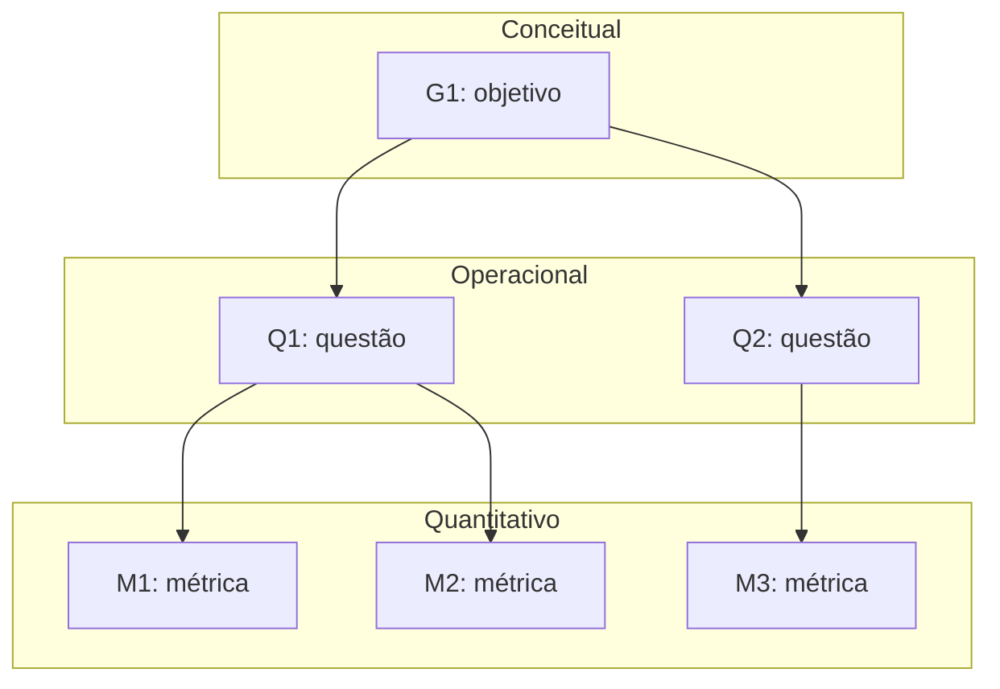

# Fase 2 — Especificar a avaliação

<!--
Referência: ISO/IEC 25040, atividade 2; método GQM (Basili).
F2-C11: deixar EXPLÍCITO como cada objetivo deriva das características e stakeholders da Fase 1.
-->

Os objetivos de medição abaixo derivam do propósito, das decisões apoiadas e das
necessidades das partes interessadas documentados na [Fase 1](fase-1.md).

A seleção e a priorização das características na [Seção 5 da Fase 1](fase-1.md#5-selecao-e-priorizacao-das-caracteristicas)
ainda estão em elaboração. Estes objetivos são iniciais e deverão ser revisados após
a consolidação dessa seção. A menção a usabilidade na Seção 2.2 da Fase 1 também
precisa ser conciliada com a orientação registrada na Seção 5 de não incluir essa
característica; não foi definido um objetivo para ela nesta etapa.

## 1. Objetivos de medição (nível conceitual)

<!--
F2-C1: usar o template GQM completo para cada objetivo.
-->

### G1 — Manutenibilidade

| Elemento | Descrição |
|----------|-----------|
| Analisar | O código-fonte do Sua Grade UnB, com foco nos componentes de coleta de dados do SIGAA e de busca de disciplinas, seleção de turmas, geração e salvamento de grades. |
| Com o propósito de | Avaliar a facilidade de manutenção e identificar os componentes que devem receber melhorias prioritárias para viabilizar correções e contribuições de voluntários. |
| Com respeito a | Manutenibilidade, com foco em analisabilidade, modificabilidade e testabilidade. |
| Do ponto de vista de | Mantenedores e contribuidores externos do Sua Grade UnB. |
| No contexto de | Uma avaliação acadêmica independente conduzida pela equipe Elizabeth Friedman, em cerca de seis semanas, de uma aplicação web em operação e mantida por voluntários, utilizando o repositório público e a reprodução local, sem acesso a logs ou ao banco de dados de produção e sem coletas repetidas no SIGAA. |

**Origem na Fase 1:** a [Seção 1.1](fase-1.md#11-contexto) registra a manutenção
por voluntários e a necessidade de adaptar a coleta de dados após mudanças no SIGAA.
O [propósito da avaliação](fase-1.md#12-proposito) inclui a continuidade da manutenção.
Na [Seção 2.2, Tabela 3](fase-1.md#22-mapa-de-partes-interessadas), as necessidades dos
mantenedores e dos contribuidores externos motivam explicitamente a manutenibilidade
e o foco em analisabilidade, modificabilidade e testabilidade. O objetivo apoia as
decisões **D1** (priorizar correções), **D2** (escolher a melhoria da Fase 4) e **D3**
(identificar por onde começar a contribuir), definidas na [Seção 1.3](fase-1.md#13-uso-pretendido-decisoes-apoiadas).

### G2 — Eficiência de desempenho

| Elemento | Descrição |
|----------|-----------|
| Analisar | O desempenho do Sua Grade UnB no fluxo de buscar disciplinas, selecionar turmas, gerar e salvar grades. |
| Com o propósito de | Avaliar o desempenho do fluxo principal e identificar operações cuja lentidão possa prejudicar o uso e deva ser priorizada nas melhorias. |
| Com respeito a | Eficiência de desempenho, com foco no comportamento temporal das operações do fluxo principal. |
| Do ponto de vista de | Estudantes da UnB que utilizam o sistema para montar a grade no período de matrícula. |
| No contexto de | Uma avaliação acadêmica independente conduzida pela equipe Elizabeth Friedman, em cerca de seis semanas, por observações no site público e medições em reprodução local sob condições documentadas, sem acesso a logs ou ao banco de dados de produção e sem gerar carga sobre o SIGAA. Os resultados ficam limitados às condições avaliadas e não demonstram, por si só, o desempenho em picos reais de matrícula. |

**Origem na Fase 1:** a [Seção 1.1](fase-1.md#11-contexto) identifica o uso recorrente
e concentrado no período de matrícula. O [propósito da avaliação](fase-1.md#12-proposito)
prevê identificar problemas que afetam os estudantes nesse período. Na
[Seção 2.2, Tabela 3](fase-1.md#22-mapa-de-partes-interessadas), os estudantes motivam
explicitamente a característica de eficiência e a avaliação dos tempos de resposta
no fluxo principal. A mesma tabela estabelece a restrição de não gerar carga sobre
o SIGAA. O objetivo apoia as decisões **D1** (priorizar correções) e **D2** (escolher a
melhoria da Fase 4), definidas na [Seção 1.3](fase-1.md#13-uso-pretendido-decisoes-apoiadas).

## 2. Questões e hipóteses (nível operacional)

<!--
F2-C2: questões que cobrem os atributos do foco de qualidade (não métricas disfarçadas de pergunta).
F2-C3: uma hipótese clara para CADA questão.
-->

### 2.1 Manutenibilidade — G1

| ID | Questão | Hipótese | Objetivo |
|----|---------|----------|----------|
| Q1 | | H1: | G1 |

### 2.2 Eficiência de desempenho — G2

As questões abaixo cobrem **comportamento temporal**, a subcaracterística selecionada
no [objetivo G2](#g2-eficiencia-de-desempenho), nas quatro operações do fluxo principal
identificadas na [Seção 2.2 da Fase 1](fase-1.md#22-mapa-de-partes-interessadas).
Utilização de recursos e capacidade não integram o recorte atual de G2.

As hipóteses são expectativas a verificar, não resultados da avaliação. Os limites
de tempo aceitáveis por operação e a regra para confirmar ou refutar cada hipótese
deverão ser definidos nas Seções 3 e 4, antes da coleta. As condições de execução,
os dados utilizados e a repetição das tarefas serão especificados no plano da
[Fase 3](fase-3.md), permitindo comparar os resultados sob condições documentadas.

| ID | Subcaracterística | Questão | Hipótese | Objetivo |
|----|-------------------|---------|----------|----------|
| Q2 | Comportamento temporal | A busca de disciplinas apresenta os resultados em tempo aceitável para o estudante dar continuidade à montagem da grade? | H2: O tempo entre solicitar uma busca por nome ou código e visualizar seus resultados atende ao limite de aceitação definido para a busca, nas condições avaliadas. | G2 |
| Q3 | Comportamento temporal | A seleção de turmas atualiza a interface em tempo aceitável para o estudante continuar selecionando as opções desejadas? | H3: O tempo entre selecionar uma turma e visualizar a atualização correspondente na interface atende ao limite de aceitação definido para a seleção, nas condições avaliadas. | G2 |
| Q4 | Comportamento temporal | A geração de combinações de turmas sem conflito apresenta as grades em tempo aceitável nos cenários de montagem avaliados? | H4: O tempo entre solicitar a geração e visualizar as combinações de grades atende ao limite de aceitação definido para a geração em cada cenário avaliado. | G2 |
| Q5 | Comportamento temporal | O salvamento de uma grade fornece retorno em tempo aceitável para o estudante concluir a tarefa? | H5: O tempo entre solicitar o salvamento e visualizar sua confirmação atende ao limite de aceitação definido para o salvamento, nas modalidades avaliadas de conta do usuário e armazenamento no navegador. | G2 |

## 3. Métricas (nível quantitativo)

<!--
F2-C4 e premissa 2: para cada métrica documentar definição, procedimento de cálculo (fórmula),
fonte dos dados, procedimento de coleta e critérios de interpretação.
Fórmulas em LaTeX: \( X = \frac{A}{B} \) em linha, ou \[ ... \] em bloco.
-->

### M1 — [Nome da métrica]

| Campo | Descrição |
|-------|-----------|
| Questão respondida | Q1 |
| Definição | |
| Fórmula | \( X = \frac{A}{B} \) |
| Fonte dos dados | |
| Procedimento de coleta | |
| Interpretação | |

## 4. Níveis de pontuação e critérios de julgamento

<!--
F2-C5: níveis de pontuação para TODAS as métricas e critérios de julgamento explícitos
(como o resultado da medição vira um julgamento).
-->

| Métrica | Insatisfatório | Aceitável | Bom | Excelente |
|---------|----------------|-----------|-----|-----------|
| M1 | | | | |

**Critério de julgamento:** *A preencher.*

## 5. Diagrama GQM

<!--
F2-C6: diagrama completo com todos os objetivos, identificando os níveis (conceitual, operacional, quantitativo).
O exemplo abaixo é só o formato; substitua pelos objetivos reais.
-->

---

Anterior: [Fase 1](fase-1.md) · Próxima: [Fase 3 — Projeto da avaliação](fase-3.md).
