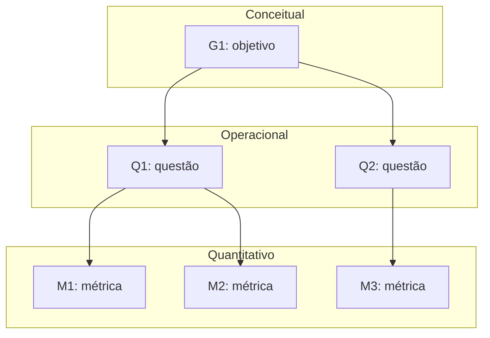

# Fase 2 — Especificar a avaliação

<!--
Referência: ISO/IEC 25040, atividade 2; método GQM (Basili).
F2-C11: deixar EXPLÍCITO como cada objetivo deriva das características e stakeholders da Fase 1.
-->

Os objetivos de medição abaixo derivam das características priorizadas e das partes
interessadas definidas na [Fase 1](fase-1.md#5-selecao-e-priorizacao-das-caracteristicas).

## 1. Objetivos de medição (nível conceitual)

<!--
F2-C1: usar o template GQM completo para cada objetivo.
-->

### G1 — [Característica]

| Elemento | Descrição |
|----------|-----------|
| Analisar | *objeto* |
| Com o propósito de | *propósito* |
| Com respeito a | *foco de qualidade* |
| Do ponto de vista de | *stakeholder* |
| No contexto de | *contexto* |

Origem na Fase 1: *característica X, priorizada por Y (ver [Fase 1](fase-1.md))*.

## 2. Questões e hipóteses (nível operacional)

<!--
F2-C2: questões que cobrem os atributos do foco de qualidade (não métricas disfarçadas de pergunta).
F2-C3: uma hipótese clara para CADA questão.
-->

| ID | Questão | Hipótese | Objetivo |
|----|---------|----------|----------|
| Q1 | | H1: | G1 |

## 3. Métricas (nível quantitativo)

<!--
F2-C4 e premissa 2: para cada métrica documentar definição, procedimento de cálculo (fórmula),
fonte dos dados, procedimento de coleta e critérios de interpretação.
Fórmulas em LaTeX: \( X = \frac{A}{B} \) em linha, ou \[ ... \] em bloco.
-->

### M1 — [Nome da métrica]

| Campo | Descrição |
|-------|-----------|
| Questão respondida | Q1 |
| Definição | |
| Fórmula | \( X = \frac{A}{B} \) |
| Fonte dos dados | |
| Procedimento de coleta | |
| Interpretação | |

## 4. Níveis de pontuação e critérios de julgamento

<!--
F2-C5: níveis de pontuação para TODAS as métricas e critérios de julgamento explícitos
(como o resultado da medição vira um julgamento).
-->

| Métrica | Insatisfatório | Aceitável | Bom | Excelente |
|---------|----------------|-----------|-----|-----------|
| M1 | | | | |

**Critério de julgamento:** *A preencher.*

## 5. Diagrama GQM

<!--
F2-C6: diagrama completo com todos os objetivos, identificando os níveis (conceitual, operacional, quantitativo).
O exemplo abaixo é só o formato; substitua pelos objetivos reais.
-->

---

Anterior: [Fase 1](fase-1.md) · Próxima: [Fase 3 — Projeto da avaliação](fase-3.md).
