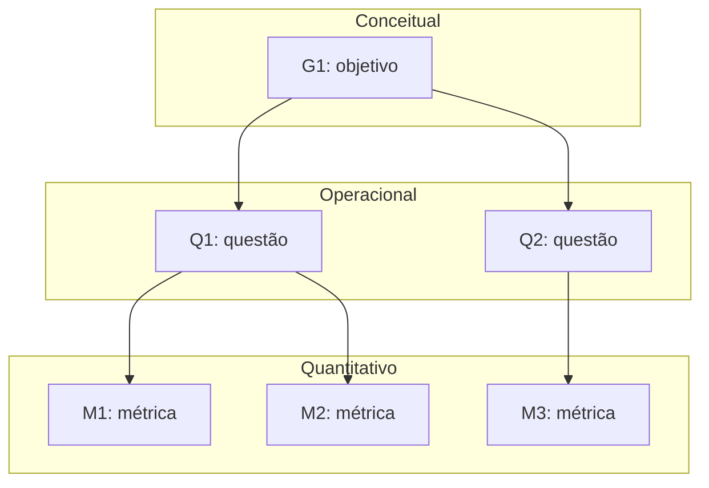

# Fase 2 — Especificar a avaliação

<!--
Referência: ISO/IEC 25040, atividade 2; método GQM (Basili).
F2-C11: deixar EXPLÍCITO como cada objetivo deriva das características e stakeholders da Fase 1.
-->

Os objetivos de medição abaixo derivam do propósito, das decisões apoiadas e das
necessidades das partes interessadas documentados na [Fase 1](fase-1.md).

A seleção e a priorização das características na [Seção 5 da Fase 1](fase-1.md#5-selecao-e-priorizacao-das-caracteristicas)
ainda estão em elaboração. Estes objetivos são iniciais e deverão ser revisados após
a consolidação dessa seção. A menção a usabilidade na Seção 2.2 da Fase 1 também
precisa ser conciliada com a orientação registrada na Seção 5 de não incluir essa
característica; não foi definido um objetivo para ela nesta etapa.

## 1. Objetivos de medição (nível conceitual)

<!--
F2-C1: usar o template GQM completo para cada objetivo.
-->

### G1 — Manutenibilidade

| Elemento | Descrição |
|----------|-----------|
| Analisar | O código-fonte do Sua Grade UnB, com foco nos componentes de coleta de dados do SIGAA e de busca de disciplinas, seleção de turmas, geração e salvamento de grades. |
| Com o propósito de | Avaliar a facilidade de manutenção e identificar os componentes que devem receber melhorias prioritárias para viabilizar correções e contribuições de voluntários. |
| Com respeito a | Manutenibilidade, com foco em analisabilidade, modificabilidade e testabilidade. |
| Do ponto de vista de | Mantenedores e contribuidores externos do Sua Grade UnB. |
| No contexto de | Uma avaliação acadêmica independente conduzida pela equipe Elizabeth Friedman, em cerca de seis semanas, de uma aplicação web em operação e mantida por voluntários, utilizando o repositório público e a reprodução local, sem acesso a logs ou ao banco de dados de produção e sem coletas repetidas no SIGAA. |

**Origem na Fase 1:** a [Seção 1.1](fase-1.md#11-contexto) registra a manutenção
por voluntários e a necessidade de adaptar a coleta de dados após mudanças no SIGAA.
O [propósito da avaliação](fase-1.md#12-proposito) inclui a continuidade da manutenção.
Na [Seção 2.2, Tabela 3](fase-1.md#22-mapa-de-partes-interessadas), as necessidades dos
mantenedores e dos contribuidores externos motivam explicitamente a manutenibilidade
e o foco em analisabilidade, modificabilidade e testabilidade. O objetivo apoia as
decisões **D1** (priorizar correções), **D2** (escolher a melhoria da Fase 4) e **D3**
(identificar por onde começar a contribuir), definidas na [Seção 1.3](fase-1.md#13-uso-pretendido-decisoes-apoiadas).

### G2 — Eficiência de desempenho

| Elemento | Descrição |
|----------|-----------|
| Analisar | O desempenho do Sua Grade UnB no fluxo de buscar disciplinas, selecionar turmas, gerar e salvar grades. |
| Com o propósito de | Avaliar o desempenho do fluxo principal e identificar operações cuja lentidão possa prejudicar o uso e deva ser priorizada nas melhorias. |
| Com respeito a | Eficiência de desempenho, com foco no comportamento temporal das operações do fluxo principal. |
| Do ponto de vista de | Estudantes da UnB que utilizam o sistema para montar a grade no período de matrícula. |
| No contexto de | Uma avaliação acadêmica independente conduzida pela equipe Elizabeth Friedman, em cerca de seis semanas, por observações no site público e medições em reprodução local sob condições documentadas, sem acesso a logs ou ao banco de dados de produção e sem gerar carga sobre o SIGAA. Os resultados ficam limitados às condições avaliadas e não demonstram, por si só, o desempenho em picos reais de matrícula. |

**Origem na Fase 1:** a [Seção 1.1](fase-1.md#11-contexto) identifica o uso recorrente
e concentrado no período de matrícula. O [propósito da avaliação](fase-1.md#12-proposito)
prevê identificar problemas que afetam os estudantes nesse período. Na
[Seção 2.2, Tabela 3](fase-1.md#22-mapa-de-partes-interessadas), os estudantes motivam
explicitamente a característica de eficiência e a avaliação dos tempos de resposta
no fluxo principal. A mesma tabela estabelece a restrição de não gerar carga sobre
o SIGAA. O objetivo apoia as decisões **D1** (priorizar correções) e **D2** (escolher a
melhoria da Fase 4), definidas na [Seção 1.3](fase-1.md#13-uso-pretendido-decisoes-apoiadas).

## 2. Questões e hipóteses (nível operacional)

<!--
F2-C2: questões que cobrem os atributos do foco de qualidade (não métricas disfarçadas de pergunta).
F2-C3: uma hipótese clara para CADA questão.
-->

### 2.1 Manutenibilidade — G1

| ID | Questão | Hipótese | Objetivo |
|----|---------|----------|----------|
| Q1 | | H1: | G1 |

### 2.2 Eficiência de desempenho — G2

As questões abaixo cobrem **comportamento temporal**, a subcaracterística selecionada
no [objetivo G2](#g2-eficiencia-de-desempenho), nas quatro operações do fluxo principal
identificadas na [Seção 2.2 da Fase 1](fase-1.md#22-mapa-de-partes-interessadas).
Utilização de recursos e capacidade não integram o recorte atual de G2.

As hipóteses são expectativas a verificar, não resultados da avaliação. Os limites
de tempo aceitáveis por operação e a regra para confirmar ou refutar cada hipótese
deverão ser definidos nas Seções 3 e 4, antes da coleta. As condições de execução,
os dados utilizados e a repetição das tarefas serão especificados no plano da
[Fase 3](fase-3.md), permitindo comparar os resultados sob condições documentadas.

| ID | Subcaracterística | Questão | Hipótese | Objetivo |
|----|-------------------|---------|----------|----------|
| Q2 | Comportamento temporal | A busca de disciplinas apresenta os resultados em tempo aceitável para o estudante dar continuidade à montagem da grade? | H2: O tempo entre solicitar uma busca por nome ou código e visualizar seus resultados atende ao limite de aceitação definido para a busca, nas condições avaliadas. | G2 |
| Q3 | Comportamento temporal | A seleção de turmas atualiza a interface em tempo aceitável para o estudante continuar selecionando as opções desejadas? | H3: O tempo entre selecionar uma turma e visualizar a atualização correspondente na interface atende ao limite de aceitação definido para a seleção, nas condições avaliadas. | G2 |
| Q4 | Comportamento temporal | A geração de combinações de turmas sem conflito apresenta as grades em tempo aceitável nos cenários de montagem avaliados? | H4: O tempo entre solicitar a geração e visualizar as combinações de grades atende ao limite de aceitação definido para a geração em cada cenário avaliado. | G2 |
| Q5 | Comportamento temporal | O salvamento de uma grade fornece retorno em tempo aceitável para o estudante concluir a tarefa? | H5: O tempo entre solicitar o salvamento e visualizar sua confirmação atende ao limite de aceitação definido para o salvamento, nas modalidades avaliadas de conta do usuário e armazenamento no navegador. | G2 |

## 3. Métricas (nível quantitativo)

<!--
F2-C4 e premissa 2: para cada métrica documentar definição, procedimento de cálculo (fórmula),
fonte dos dados, procedimento de coleta e critérios de interpretação.
Fórmulas em LaTeX: \( X = \frac{A}{B} \) em linha, ou \[ ... \] em bloco.
-->

### 3.1 Convenções de medição de eficiência de desempenho

As métricas **M2 a M5** respondem, respectivamente, às questões **Q2 a Q5** do
objetivo **G2**, cobrindo comportamento temporal. A métrica M1 permanece reservada
à questão de manutenibilidade, ainda em elaboração.

Para cada operação e cenário, executar duas tentativas de aquecimento, registradas
e excluídas do cálculo, seguidas de **30 tentativas medidas**, sequenciais e sem
concorrência. Esse tamanho de amostra é uma escolha operacional inicial da equipe;
não representa uma garantia estatística sobre o uso em produção. Restaurar o estado
inicial antes de cada tentativa e manter os mesmos dados, navegador, equipamento,
rede e política de cache dentro de cada cenário. Documentar essas condições na
Fase 3. Separar os resultados por cenário e ambiente, sem misturar medições locais
com observações do site público. A coleta repetida será realizada em reprodução
local com dados previamente disponíveis, sem acionar a coleta do SIGAA.

Medir o intervalo entre a ação do usuário e o resultado visível na interface,
incluindo processamento, comunicação e atualização visual. Usar um mesmo relógio
monotônico no navegador e registrar os eventos em um roteiro automatizado ou em
uma instrumentação local reproduzível. Tempos de requisições de rede isoladas não
substituem esse intervalo. Os seletores e sinais de conclusão serão confirmados
na preparação do roteiro na Fase 3, conforme o comportamento real da aplicação.

Para cada tentativa concluída com sucesso:

\[
t_i = t_{\mathrm{fim},i} - t_{\mathrm{início},i}
\]

Os tempos são expressos em **milissegundos (ms)**. Ordenando os tempos válidos de
forma crescente, calcular o percentil 95 pelo método do posto mais próximo:

\[
P_{95}(t) = t_{(\lceil 0{,}95n \rceil)}
\]

Nessa fórmula, \(n\) é o número de tentativas medidas concluídas com sucesso e
\(t_{(k)}\) é o tempo na posição \(k\) da série ordenada. Com 30 sucessos, utiliza-se
o 29º tempo. Com nenhum sucesso, o percentil é **não calculável**.

Registrar as 30 tentativas, incluindo erros e expiração do tempo de espera, sem
substituí-los por novas tentativas ou tratá-los como tempos iguais a zero. O tempo
máximo de espera por operação será fixado na Fase 3, antes da coleta, e deverá ser
superior ao respectivo limite de aceitação. Publicar o número de sucessos, erros e
expirações junto ao percentil; este descreve apenas as tentativas bem-sucedidas.
Ocorrências de falha impedem confirmar a hipótese apenas com base em um percentil
baixo e devem ser consideradas na regra de julgamento da Seção 4.

Guardar os dados brutos em CSV com: métrica, cenário, ambiente, versão do sistema,
data, número da tentativa, indicação de aquecimento, instante inicial, instante
final, duração, estado (sucesso, erro ou expiração) e referência à evidência.
Registrar a configuração do ambiente e a massa de dados junto ao arquivo.

Para cada métrica, **menor é melhor**. O resultado atende ao requisito temporal
quando \(M_j \leq L_j\), em que \(L_j\) é o limite de aceitação da operação e do
cenário, em ms. Os valores de \(L_2\) a \(L_5\), sua justificativa e os níveis de
pontuação serão definidos na Seção 4 **antes da coleta**. Até essa definição, as
métricas permitem descrever os tempos, mas não confirmar as hipóteses de aceitação.

### M1 — Manutenibilidade (a definir)

| Campo | Descrição |
|-------|-----------|
| Questão respondida | Q1 |
| Definição | |
| Fórmula | \( X = \frac{A}{B} \) |
| Fonte dos dados | |
| Procedimento de coleta | |
| Interpretação | |

### M2 — Tempo de resposta da busca de disciplinas (P95)

| Campo | Descrição |
|-------|-----------|
| Questão respondida | Q2 — hipótese H2; objetivo G2. |
| Definição | Percentil 95 do tempo entre a ação que solicita a busca e a exibição dos resultados correspondentes ao termo informado, com a interface pronta para interação. |
| Fórmula | \(M_2 = P_{95}(t_{\mathrm{busca}})\), em ms, conforme a Seção 3.1. |
| Fonte dos dados | Registros de eventos do navegador na reprodução local, arquivo CSV das tentativas e evidências da atualização dos resultados. |
| Procedimento de coleta | Preparar cenários separados para busca por nome e por código, com termos e resultados esperados fixos. Iniciar a marcação na ação que dispara a busca; se houver busca automática, usar o último evento de entrada do termo, incluindo eventual espera programada pela aplicação. Encerrar quando os resultados correspondentes estiverem visíveis e utilizáveis, sem confundir resultados anteriores com os da nova busca. Executar o protocolo da Seção 3.1 para cada cenário. |
| Interpretação | Comparar cada cenário com \(L_2\). Um resultado acima do limite indica demora na busca sob as condições medidas. Interpretar junto aos erros e expirações; o resultado não demonstra desempenho em picos de matrícula. |

### M3 — Tempo de atualização após seleção de turma (P95)

| Campo | Descrição |
|-------|-----------|
| Questão respondida | Q3 — hipótese H3; objetivo G2. |
| Definição | Percentil 95 do tempo entre selecionar uma turma e visualizar a atualização completa do estado de seleção na interface. |
| Fórmula | \(M_3 = P_{95}(t_{\mathrm{seleção}})\), em ms, conforme a Seção 3.1. |
| Fonte dos dados | Registros de eventos de seleção e atualização visual do navegador na reprodução local, arquivo CSV e evidências do estado selecionado. |
| Procedimento de coleta | Fixar a disciplina, a turma e as seleções anteriores de cada cenário. Iniciar a marcação na ação de selecionar a turma e encerrar quando os indicadores visuais correspondentes refletirem o novo estado e a interface permitir continuar a tarefa. Restaurar as seleções iniciais entre tentativas, fora do intervalo medido. Executar o protocolo da Seção 3.1. |
| Interpretação | Comparar cada cenário com \(L_3\). Um resultado acima do limite indica atraso na atualização após a seleção, nas condições medidas. Uma atualização ausente ou incorreta é registrada como erro, não como resposta rápida. |

### M4 — Tempo de geração de grades (P95)

| Campo | Descrição |
|-------|-----------|
| Questão respondida | Q4 — hipótese H4; objetivo G2. |
| Definição | Percentil 95 do tempo entre solicitar a geração e concluir a apresentação das combinações de grades previstas pelo fluxo da aplicação para o conjunto selecionado. |
| Fórmula | \(M_4 = P_{95}(t_{\mathrm{geração}})\), em ms, conforme a Seção 3.1. |
| Fonte dos dados | Registros de acionamento e conclusão da geração no navegador da reprodução local, massa de dados de disciplinas e turmas, arquivo CSV e evidências das grades apresentadas. |
| Procedimento de coleta | Preparar conjuntos fixos de disciplinas e turmas com combinações válidas conhecidas. Documentar por cenário as quantidades de disciplinas, turmas candidatas e combinações válidas esperadas. Iniciar a marcação na solicitação de geração e encerrar quando o processamento e a apresentação previstos pelo fluxo estiverem concluídos e o estudante puder consultar as grades. Não encerrar apenas ao aparecer um indicador de carregamento ou um resultado parcial. Executar o protocolo da Seção 3.1 e calcular o percentil separadamente para cada conjunto. |
| Interpretação | Comparar cada cenário com \(L_4\). Tempos acima do limite indicam demora na geração para aquele conjunto. Comparações entre conjuntos ajudam a identificar sensibilidade ao volume de combinações, mas não estabelecem a capacidade máxima do sistema. Resultados incompatíveis com a massa de referência são registrados como erro. |

### M5 — Tempo de retorno do salvamento de grade (P95)

| Campo | Descrição |
|-------|-----------|
| Questão respondida | Q5 — hipótese H5; objetivo G2. |
| Definição | Percentil 95 do tempo entre solicitar o salvamento de uma grade e visualizar o sinal de conclusão bem-sucedida fornecido pela interface. |
| Fórmula | \(M_5 = P_{95}(t_{\mathrm{salvamento}})\), em ms, conforme a Seção 3.1. |
| Fonte dos dados | Registros de eventos de salvamento e de sua confirmação no navegador da reprodução local, arquivo CSV e evidências da recuperação da grade salva. |
| Procedimento de coleta | Preparar uma grade fixa e cenários separados para salvamento na conta de teste e no navegador, conforme as modalidades disponíveis. Concluir autenticação e preparação antes da marcação. Iniciar ao solicitar o salvamento e encerrar na confirmação visual. Depois do intervalo medido, verificar se a grade pode ser recuperada; uma confirmação sem persistência verificada conta como erro. Restaurar o estado inicial entre tentativas e executar o protocolo da Seção 3.1. Se uma modalidade não puder ser reproduzida, registrar a limitação e não lhe atribuir resultado. |
| Interpretação | Comparar separadamente cada modalidade com \(L_5\). Tempos acima do limite indicam demora no retorno do salvamento. Um retorno rápido sem persistência não confirma H5. O tempo de autenticação e o de recuperação usado na verificação não integram esta métrica. |

## 4. Níveis de pontuação e critérios de julgamento

<!--
F2-C5: níveis de pontuação para TODAS as métricas e critérios de julgamento explícitos
(como o resultado da medição vira um julgamento).
-->

| Métrica | Insatisfatório | Aceitável | Bom | Excelente |
|---------|----------------|-----------|-----|-----------|
| M1 | | | | |

**Critério de julgamento:** *A preencher.*

## 5. Diagrama GQM

<!--
F2-C6: diagrama completo com todos os objetivos, identificando os níveis (conceitual, operacional, quantitativo).
O exemplo abaixo é só o formato; substitua pelos objetivos reais.
-->

---

Anterior: [Fase 1](fase-1.md) · Próxima: [Fase 3 — Projeto da avaliação](fase-3.md).
