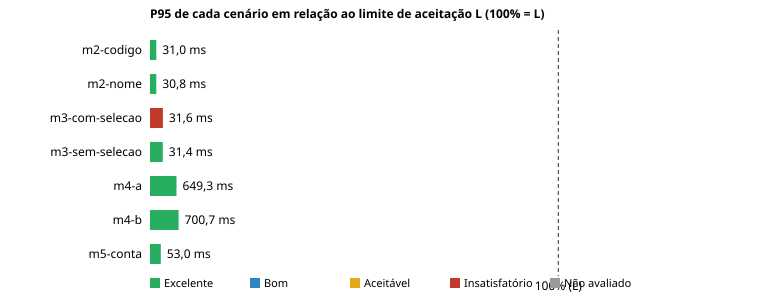
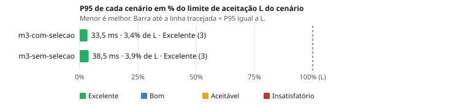

# Fase 4 — Executar a avaliação e resultados

<!--
Referência: ISO/IEC 25040, atividades 4 e 5.
-->

## 1. Obtenção das medidas

<!--
F4-C1 e F4-C2: coleta seguindo o plano da Fase 3; ligação DIRETA entre cada dado bruto
(arquivo, formulário, log, vídeo) e a métrica calculada.
Dados de participantes: anonimizar e descrever as condições de acesso (premissa 5).
-->

| Métrica | Data da coleta | Responsável | Dados brutos | Procedimento de cálculo |
|---------|----------------|-------------|--------------|-------------------------|
| M1.1 — Modularidade | 15/11/2026 | Kaleb | [ciclos.json](avaliacao/dados/g1/m1-1-ciclos.json), [grafo do Madge](avaliacao/dados/g1/m1-1-madge-frontend.json); pacote completo em [`formal/estatica/`](https://github.com/FCTE-Qualidade-de-Software-1/2026-2_T02_ELIZABETH_FRIEDMAN/tree/main/avaliacao/manutenibilidade/evidencias/formal/estatica) | [Roteiro de M1.1](https://github.com/FCTE-Qualidade-de-Software-1/2026-2_T02_ELIZABETH_FRIEDMAN/blob/main/avaliacao/manutenibilidade/README.md#m11--ciclos-de-importação), [`ciclos.py`](https://github.com/FCTE-Qualidade-de-Software-1/2026-2_T02_ELIZABETH_FRIEDMAN/blob/main/avaliacao/manutenibilidade/ciclos.py), [auditoria dos ciclos](https://github.com/FCTE-Qualidade-de-Software-1/2026-2_T02_ELIZABETH_FRIEDMAN/tree/main/avaliacao/manutenibilidade/evidencias/formal/estatica/auditoria-ciclos.md) e [resultados](avaliacao/dados/g1/m1-1-m1-2-resultados.csv) |
| M1.2 — Analisabilidade | 15/11/2026 | Kaleb | [blocos do Radon](avaliacao/dados/g1/m1-2-radon-blocos.json), [blocos do ESLint](avaliacao/dados/g1/m1-2-eslint-blocos.json), [maiores CC por recorte](avaliacao/dados/g1/m1-2-maximos-cc.json); pacote completo em [`formal/estatica/`](https://github.com/FCTE-Qualidade-de-Software-1/2026-2_T02_ELIZABETH_FRIEDMAN/tree/main/avaliacao/manutenibilidade/evidencias/formal/estatica) | [Roteiro de M1.2](https://github.com/FCTE-Qualidade-de-Software-1/2026-2_T02_ELIZABETH_FRIEDMAN/blob/main/avaliacao/manutenibilidade/README.md#m12--complexidade-ciclomática), [`coletar.py`](https://github.com/FCTE-Qualidade-de-Software-1/2026-2_T02_ELIZABETH_FRIEDMAN/blob/main/avaliacao/manutenibilidade/coletar.py) e [resultados](avaliacao/dados/g1/m1-1-m1-2-resultados.csv) |
| M1.3 — Modificabilidade | 12/11/2026 | Joaquim  | [Patches de C1 e C2](https://github.com/FCTE-Qualidade-de-Software-1/2026-2_T02_ELIZABETH_FRIEDMAN/tree/main/avaliacao/manutenibilidade/evidencias/M1.3) e [verificação a posteriori](https://github.com/FCTE-Qualidade-de-Software-1/2026-2_T02_ELIZABETH_FRIEDMAN/tree/main/avaliacao/manutenibilidade/evidencias/M1.3/verificacao-a-posteriori) (relatório e logs) | [Roteiro de M1.3](https://github.com/FCTE-Qualidade-de-Software-1/2026-2_T02_ELIZABETH_FRIEDMAN/blob/main/avaliacao/manutenibilidade/README.md#m13--mudanças-controladas) e [relatório da verificação](https://github.com/FCTE-Qualidade-de-Software-1/2026-2_T02_ELIZABETH_FRIEDMAN/tree/main/avaliacao/manutenibilidade/evidencias/M1.3/verificacao-a-posteriori/RELATORIO.md) |
| M1.4 — Testabilidade | 15/11/2026 | Kaleb | [`coverage.json`](avaliacao/dados/g1/m1-4-coverage.json), [auditoria do inventário](avaliacao/dados/g1/m1-4-auditoria-inventario.json), [ambiente](avaliacao/dados/g1/m1-4-ambiente.txt); log e demais arquivos em [`formal/M1.4/`](https://github.com/FCTE-Qualidade-de-Software-1/2026-2_T02_ELIZABETH_FRIEDMAN/tree/main/avaliacao/manutenibilidade/evidencias/formal/M1.4/execucao-docker) | [Roteiro de M1.4](https://github.com/FCTE-Qualidade-de-Software-1/2026-2_T02_ELIZABETH_FRIEDMAN/blob/main/avaliacao/manutenibilidade/README.md#m14--cobertura-de-linhas), [`cobertura.sh`](https://github.com/FCTE-Qualidade-de-Software-1/2026-2_T02_ELIZABETH_FRIEDMAN/blob/main/avaliacao/manutenibilidade/cobertura.sh), [`resumir_cobertura.py`](https://github.com/FCTE-Qualidade-de-Software-1/2026-2_T02_ELIZABETH_FRIEDMAN/blob/main/avaliacao/manutenibilidade/resumir_cobertura.py) e [resultados](avaliacao/dados/g1/m1-4-resultados.csv) |
| M2 — Busca | 15/11/2026 | Joaquim (coleta), Júlia (análise) | [`m2-nome.csv`](avaliacao/dados/g2/20261115-2128/m2-nome.csv), [`m2-codigo.csv`](avaliacao/dados/g2/20261115-2128/m2-codigo.csv); [`evidencias.jsonl`](avaliacao/dados/g2/20261115-2128/evidencias.jsonl), [capturas](https://github.com/FCTE-Qualidade-de-Software-1/2026-2_T02_ELIZABETH_FRIEDMAN/tree/main/docs/avaliacao/dados/g2/20261115-2128/evidencias) e [`metadados.json`](avaliacao/dados/g2/20261115-2128/metadados.json) | [Fase 3, 1.1.7](fase-3.md#117-registro-e-calculo-do-p95), [`analisar_g2.py`](https://github.com/FCTE-Qualidade-de-Software-1/2026-2_T02_ELIZABETH_FRIEDMAN/blob/main/avaliacao/analise/analisar_g2.py) e [resultados](avaliacao/dados/g2/20261115-2128/analise/resultados.csv) |
| M3 — Seleção | 16/11/2026 (recoleta; a rodada de 15/11/2026 fica como registro) | João (recoleta), Júlia (análise) | [`m3-sem-selecao.csv`](avaliacao/dados/g2/20261116-0102/m3-sem-selecao.csv), [`m3-com-selecao.csv`](avaliacao/dados/g2/20261116-0102/m3-com-selecao.csv); [`evidencias.jsonl`](avaliacao/dados/g2/20261116-0102/evidencias.jsonl), [capturas](https://github.com/FCTE-Qualidade-de-Software-1/2026-2_T02_ELIZABETH_FRIEDMAN/tree/main/docs/avaliacao/dados/g2/20261116-0102/evidencias), [`metadados.json`](avaliacao/dados/g2/20261116-0102/metadados.json) e [ambiente da recoleta](avaliacao/dados/g2/20261116-0102/AMBIENTE.md). Rodada anterior: [`20261115-2128`](avaliacao/dados/g2/20261115-2128/m3-com-selecao.csv) | [Fase 3, 1.1.7](fase-3.md#117-registro-e-calculo-do-p95), [`analisar_g2.py`](https://github.com/FCTE-Qualidade-de-Software-1/2026-2_T02_ELIZABETH_FRIEDMAN/blob/main/avaliacao/analise/analisar_g2.py) e [resultados](avaliacao/dados/g2/20261116-0102/analise/resultados.csv) |
| M4 — Geração | 15/11/2026 | Joaquim (coleta), Júlia (análise) | [`m4-a.csv`](avaliacao/dados/g2/20261115-2128/m4-a.csv), [`m4-b.csv`](avaliacao/dados/g2/20261115-2128/m4-b.csv); [`evidencias.jsonl`](avaliacao/dados/g2/20261115-2128/evidencias.jsonl), [capturas](https://github.com/FCTE-Qualidade-de-Software-1/2026-2_T02_ELIZABETH_FRIEDMAN/tree/main/docs/avaliacao/dados/g2/20261115-2128/evidencias) e [`metadados.json`](avaliacao/dados/g2/20261115-2128/metadados.json) | [Fase 3, 1.1.7](fase-3.md#117-registro-e-calculo-do-p95), [`analisar_g2.py`](https://github.com/FCTE-Qualidade-de-Software-1/2026-2_T02_ELIZABETH_FRIEDMAN/blob/main/avaliacao/analise/analisar_g2.py) e [resultados](avaliacao/dados/g2/20261115-2128/analise/resultados.csv) |
| M5 — Salvamento | 15/11/2026 | Joaquim (coleta), Júlia (análise) | [`m5-conta.csv`](avaliacao/dados/g2/20261115-2128/m5-conta.csv); [`evidencias.jsonl`](avaliacao/dados/g2/20261115-2128/evidencias.jsonl), [capturas](https://github.com/FCTE-Qualidade-de-Software-1/2026-2_T02_ELIZABETH_FRIEDMAN/tree/main/docs/avaliacao/dados/g2/20261115-2128/evidencias) e [`metadados.json`](avaliacao/dados/g2/20261115-2128/metadados.json) | [Fase 3, 1.1.7](fase-3.md#117-registro-e-calculo-do-p95), [`analisar_g2.py`](https://github.com/FCTE-Qualidade-de-Software-1/2026-2_T02_ELIZABETH_FRIEDMAN/blob/main/avaliacao/analise/analisar_g2.py) e [resultados](avaliacao/dados/g2/20261115-2128/analise/resultados.csv) |
| M6, M7 e M9 — Interação (sessões P01 a P04) | 15/11/2026 | Júlia (moderadora) e Eduardo (observador) | [`m6-m9-sessoes.csv`](avaliacao/dados/g3/m6-m9-sessoes.csv); vídeos e transcrições em acesso restrito, citados pelo código e pelo tempo do vídeo | [Protocolo 0.3](avaliacao-interacao/protocolo.md), [instrumentos](avaliacao-interacao/instrumentos.md) e [resultados por recorte](avaliacao/dados/g3/m6-m9-resultados.csv) |
| M8 — Proteção contra perda | 16/11/2026 | Eduardo | [`m8-inventario.csv`](avaliacao/dados/g3/m8-inventario.csv), [`m8-observacoes.csv`](avaliacao/dados/g3/m8-observacoes.csv) e [capturas](https://github.com/FCTE-Qualidade-de-Software-1/2026-2_T02_ELIZABETH_FRIEDMAN/tree/main/docs/avaliacao/dados/g3/m8-capturas) de antes, aviso e depois | [Instrumentos, seção 1](avaliacao-interacao/instrumentos.md#1-inventario-m8) e [resultados por recorte](avaliacao/dados/g3/m6-m9-resultados.csv) |

## 2. Análise e respostas ao GQM

<!--
F4-C3: resultado de cada métrica comparado aos níveis de pontuação da Fase 2,
resposta a TODAS as questões e objetivos, com gráficos e tabelas.
-->

### 2.1 G1 — Manutenibilidade

Medições sobre o Sua Grade UnB no commit `3d399e745383b05e8e3b1a7c97ac0fdbf93a0360`,
sem alterações rastreadas. Os valores seguem as faixas da
[Fase 2, seção 4.1](fase-2.md#41-escala-e-faixas-por-metrica) e foram classificados sem
arredondamento prévio. Os percentuais não são combinados entre recortes de denominadores
diferentes, e as notas não são calculadas em média, conforme a
[seção 4.5](fase-2.md#45-julgamento-das-hipoteses-de-manutenibilidade).

**Tabela 1 — Resultados de G1 por métrica e recorte**

| Métrica | Recorte | Numerador / denominador | Valor | Faixa da nota | Nota |
|---------|---------|-------------------------|-------|---------------|------|
| M1.1 (% de arquivos em ciclos) | API | 2 / 50 | 4,00% | >0 a 5% | 2 |
| M1.1 | Frontend | 3 / 60 | 5,00% | >0 a 5% (limite superior) | 2 |
| M1.2 (% de blocos com CC > 10) | API | 1 / 137 | 0,73% | 0 a 5% | 3 |
| M1.2 | Frontend | 0 / 213 | 0,00% | 0 a 5% | 3 |
| M1.2 | *Scraper* | 0 / 18 | 0,00% | 0 a 5% | 3 |
| M1.2 | Gerador | 0 / 15 | 0,00% | 0 a 5% | 3 |
| M1.3 (minutos até a mudança validada) | C1 | — | 20 min, autodeclarado pelo executor, com medição no próprio celular do executor; patch aprovado na suíte completa na verificação posterior | — | Sem nota (tempo autodeclarado) |
| M1.3 | C2 | — | 20 min, autodeclarado pelo executor, com medição no próprio celular do executor; patch reprova na suíte completa (9 falhas) | — | Não concluída; sem nota |
| M1.4 (% de linhas cobertas) | API | 1.143 / 1.396 | 81,88% | 80% a menos de 90% | 2 |
| M1.4 | *Scraper* | 156 / 160 | 97,50% | 90% ou mais | 3 |
| M1.4 | Gerador | 140 / 141 | 99,29% | 90% ou mais | 3 |

Os blocos de M1.2 do recorte da API incluem os do *scraper* e do gerador. O *frontend* não
tem testes automatizados e, por isso, fica fora de M1.4.

**Q1.1 — Modularidade (H1.1).** Sim, nas condições medidas. A API tem um componente cíclico
de dois arquivos (`api/serializers.py` e `utils/db_handler.py`, que se importam
mutuamente nas linhas 4 e 2) e o *frontend*, um de três
(`SignInSection.tsx`, `useUser.ts` e `UserContext.tsx`, em que o ciclo se fecha por uma
referência de tipo). Os dois recortes ficam abaixo de 10% e recebem nota 2, então H1.1 tem
sustentação operacional. O *frontend* está exatamente no limite superior da faixa da nota 2:
com um arquivo a mais em ciclo (4/60, 6,67%), cairia para a nota 1. A medida conta arquivos
em ciclos de importação estáticos; não mede o tamanho do ciclo nem o custo de desfazê-lo.

**Q1.2 — Analisabilidade (H1.2).** Sim. Apenas um dos 137 blocos da API tem CC acima de 10
(`GenerateSchedule.post`, em [`views.py` linha 194](https://github.com/unb-mds/2023-2-SuaGradeUnB/blob/3d399e745383b05e8e3b1a7c97ac0fdbf93a0360/api/api/views/views.py#L194), CC 15);
o *frontend* não tem nenhum entre 213. Nos componentes críticos, o maior valor do *scraper* é
7 (`make_disciplines`, `web_scraping.py` linha 200) e o do gerador é 6 (`_valid_schedule`,
linha 153, e `generate`, linha 209). Os quatro recortes ficam na nota 3 e H1.2 tem sustentação
operacional. Esses máximos são diagnóstico e não geram nota adicional (dados em
[`m1-2-maximos-cc.json`](avaliacao/dados/g1/m1-2-maximos-cc.json)). Radon (Python) e ESLint
(TypeScript) contam construções de forma própria; por isso cada recorte é comparado com a
faixa e não com os demais.

**Q1.3 — Modificabilidade (H1.3).** Inconclusivo. O integrante Joaquim entregou os
*patches* de C1 e C2 em 12/11/2026 (commit `18bd323`) e, em mensagem a Kaleb em 15/11/2026,
declarou: "Realizei C1 e C2 em 20 min cada. Cronometrado pelo meu próprio celular". O tempo é, portanto, autodeclarado, e o log de C2 arquivado na `main`
mostra apenas um erro de ambiente. Por isso ele não foi usado como medida.

Em 15/11/2026 a equipe aplicou os dois *patches* sobre o commit inicial do produto e rodou
a suíte completa da API ([relatório e logs](https://github.com/FCTE-Qualidade-de-Software-1/2026-2_T02_ELIZABETH_FRIEDMAN/tree/main/avaliacao/manutenibilidade/evidencias/M1.3/verificacao-a-posteriori/RELATORIO.md)). O *patch* de C1 passa
(110 testes, os dois novos incluídos). O de C2 não: dos 114 testes, 9 falham, sendo 8 nos
próprios testes novos (a mensagem de erro, que contém `[1, 3]`, é usada como expressão
regular e não casa) e 1 em teste existente, que passa isolado. Pelo critério de conclusão
da Fase 2, C2 não está concluída. A verificação foi feita fora do Docker do projeto e
não mede tempo.

Pelo item 4 da seção 4.5 da Fase 2, H1.3 fica **inconclusiva** e M1.3 não recebe nota. Se o
*patch* de C2 fosse tomado como entrega final de uma execução válida, seria insucesso e
nota 0, o que contrariaria H1.3; essa leitura não foi adotada porque a execução original não
tem registro, mas fica declarada. Os resultados de M1.1, M1.2 e M1.4 apoiam Q1.3 apenas como
contexto: *scraper* e gerador têm CC máxima baixa (7 e 6) e cobertura alta (97,50% e
99,29%), mas isso não prova que uma mudança seja rápida, correta e sem regressão. Uma
execução cronometrada, registrada e feita por um executor que não conheça as mudanças é
necessária para responder Q1.3.

**Q1.4 — Testabilidade (H1.4).** Sim. A suíte original, com 108 testes, passou (código de
saída 0) e cobre 81,88% das linhas executáveis da API (nota 2), 97,50% do *scraper* e 99,29%
do gerador (nota 3). H1.4 tem sustentação operacional. A cobertura da API está a cerca de
8 pontos percentuais da faixa seguinte (90%). Sete arquivos de produção com linhas
executáveis não executaram nenhuma linha durante a suíte e concentram 211 das 253 linhas
não cobertas: `api/management/commands/updatedb.py` (122), `utils/management/commands/updatemock.py` (36),
`api/views/get_schedules.py` (16), `api/management/commands/initadmin.py` (14),
`core/settings/prod.py` (13), `core/wsgi.py` (5) e `core/asgi.py` (5). Os 42 restantes
estão espalhados em arquivos parcialmente cobertos. A medida é de linhas, sem ramos, e não
indica se as asserções detectariam defeitos.

**G1 — Resumo por subcaracterística.** G1 não recebe nota única, porque falta a medida de
modificabilidade e as notas ordinais não são combinadas.

| Subcaracterística | Hipótese | Resultado | Categoria sintética (menor nota) |
|-------------------|----------|-----------|----------------------------------|
| Modularidade | H1.1 | Sustentada operacionalmente | 2 (API 2; *frontend* 2) |
| Analisabilidade | H1.2 | Sustentada operacionalmente | 3 (API, *frontend*, *scraper* e gerador com 3) |
| Modificabilidade | H1.3 | Inconclusiva (M1.3 não avaliada) | Não atribuída |
| Testabilidade | H1.4 | Sustentada operacionalmente | 2 (API 2; *scraper* 3; gerador 3) |

Nenhum recorte medido contraria uma hipótese. O julgamento global de G1 em relação ao
propósito do produto depende de M1.3 e será tratado na seção 3.

**Limitações.** (a) São indicadores indiretos de manutenibilidade, medidos em um único commit.
(b) Não há medida de testabilidade do *frontend*, que não possui testes. (c) A cobertura é de
linhas, sem ramos. (d) M1.1 e M1.2 foram executadas em ambiente com Python 3.13 e Node 22;
o piloto de 08/11/2026 usou Python 3.12 e Node 24 e deu os mesmos seis valores. (e) M1.4 foi
executada em contêineres `linux/amd64` emulados em um computador com Apple Silicon
(arm64), com PostgreSQL 16.16 e Redis 8.10.3; o resultado coincide com o do piloto
(1.143/1.396, 156/160 e 140/141). Detalhes de ambiente em
[`m1-4-ambiente.txt`](avaliacao/dados/g1/m1-4-ambiente.txt).

### 2.2 G2 — Eficiência de desempenho

Rodada formal `20261115-2128`, executada em 15/11/2026 das 21h28 às 21h37 sobre o Sua Grade
UnB no commit `3d399e745383b05e8e3b1a7c97ac0fdbf93a0360`, sem alterações rastreadas, em
reprodução local com Docker Compose (`db`, `redis`, `api`, `web`), Chromium 151.0.7922.34
*headless* com Playwright 1.62.1, viewport 1280×720, um *worker* e sem novas tentativas
automáticas. A massa é a de referência da [Fase 3, seção 2.3](fase-3.md#23-massa-de-referencia)
(departamento 1499, 14 disciplinas, 43 turmas, período 2026/2). Cada cenário teve 2 tentativas
de aquecimento, descartadas do cálculo, e 30 tentativas medidas. O P95 é o 29º tempo dos
sucessos ordenados (posto mais próximo, [Fase 2, seção 3.1](fase-2.md#31-convencoes-de-medicao-de-eficiencia-de-desempenho)),
comparado sem arredondamento com as faixas da [seção 4.1](fase-2.md#41-escala-e-faixas-por-metrica)
e julgado pelas regras da [seção 4.3](fase-2.md#43-regras-de-aplicacao-e-julgamento-de-eficiencia-m2m5).
Os valores foram recalculados a partir dos CSVs pelo [`analisar_g2.py`](https://github.com/FCTE-Qualidade-de-Software-1/2026-2_T02_ELIZABETH_FRIEDMAN/blob/main/avaliacao/analise/analisar_g2.py)
([saída completa](avaliacao/dados/g2/20261115-2128/analise/resumo.md)).

**Tabela 2 — Resultados de G2 por métrica e cenário (30 tentativas medidas por cenário)**

| Métrica | Cenário | Sucessos / erros / expirações | Mínimo | Mediana | Máximo | P95 | Limite $L_j$ | P95 em % de $L_j$ | Classificação final |
|---------|---------|-------------------------------|--------|---------|--------|-----|--------------|-------------------|---------------------|
| M2 | `m2-nome` (termo `seminario`, 3 disciplinas) | 30 / 0 / 0 | 28,2 ms | 29,7 ms | 31,0 ms | **30,8 ms** | 2000 ms | 1,5% | Excelente (3) |
| M2 | `m2-codigo` (termo `PPGPS2475`, 1 disciplina) | 30 / 0 / 0 | 28,3 ms | 29,7 ms | 62,7 ms | **31,0 ms** | 2000 ms | 1,6% | Excelente (3) |
| M3 | `m3-sem-selecao` (`PPGPS2475/01`), rodada `20261116-0102` | 30 / 0 / 0 | 24,1 ms | 28,1 ms | 64,8 ms | **38,5 ms** | 1000 ms | 3,8% | Excelente (3) |
| M3 | `m3-com-selecao` (`PPGPS0156/04` com `/02` já selecionada), rodada `20261116-0102` | 30 / 0 / 0 | 23,3 ms | 27,2 ms | 34,3 ms | **33,5 ms** | 1000 ms | 3,4% | Excelente (3) |
| M4 | `m4-a` (2 turmas, 1 grade) | 30 / 0 / 0 | 597,3 ms | 614,0 ms | 666,4 ms | **649,3 ms** | 10000 ms | 6,5% | Excelente (3) |
| M4 | `m4-b` (16 turmas, 128 candidatas, 5 grades) | 30 / 0 / 0 | 636,9 ms | 652,0 ms | 739,9 ms | **700,7 ms** | 10000 ms | 7,0% | Excelente (3) |
| M5 | `m5-conta` (salvamento na conta, persistência conferida) | 30 / 0 / 0 | 29,1 ms | 31,6 ms | 67,0 ms | **53,0 ms** | 2000 ms | 2,6% | Excelente (3) |

As linhas de M3 vêm da recoleta `20261116-0102`, que mediu os dois cenários de M3 de novo, juntos, depois da correção do roteiro (ver abaixo); as demais vêm da rodada `20261115-2128`. Na rodada `20261115-2128`, `m3-sem-selecao` teve 30 sucessos e P95 de 31,4 ms, e `m3-com-selecao` ficou Não avaliado. Mínimo, mediana e máximo são descritivos e não entram na nota. A faixa Excelente termina em
500 ms (M2 e M5), 100 ms (M3) e 1000 ms (M4).

**Figura 1 — P95 de cada cenário em relação ao seu limite de aceitação.** A linha tracejada é
o limite $L_j$ (100%). Os valores estão em [`resultados.csv`](avaliacao/dados/g2/20261115-2128/analise/resultados.csv). Esta figura é da rodada `20261115-2128`; M3 está na Figura 2.

**Figura 2 — P95 dos cenários de M3 na recoleta `20261116-0102`.** Os valores estão na Tabela 2 e em [`resultados.csv`](avaliacao/dados/g2/20261116-0102/analise/resultados.csv).

**Por que `m3-com-selecao` não recebeu nota.** As 20 tentativas sem sucesso falharam todas
na **preparação**, antes do clique que inicia a medição, com o mesmo motivo registrado em
[`evidencias.jsonl`](avaliacao/dados/g2/20261115-2128/evidencias.jsonl): "estado não limpo (turmas marcadas = 0,
esperado 1)". Para montar a pré-condição, o roteiro seleciona `PPGPS0156/02`, refaz a busca
da mesma disciplina para expandir a turma-alvo e confere quantas turmas aparecem marcadas,
sem esperar a lista terminar de ser redesenhada. As capturas dessas tentativas (por exemplo,
[`m3-com-selecao-1.png`](avaliacao/dados/g2/20261115-2128/evidencias/m3-com-selecao-1.png)) mostram `PPGPS0156/02`
marcada logo depois. Os erros se alternam com os sucessos (houve sucesso nas tentativas 3, 4,
6, 9, 12 a 15, 23 e 26), o padrão de uma condição de corrida no roteiro. Nenhuma tentativa chegou a medir uma
seleção que tenha falhado na aplicação. Pela regra 1 da seção 4.3 da Fase 2 ("defeito no
roteiro recebe o estado Não avaliado, sem nota"), o cenário não é classificado. A regra 2
(qualquer erro leva a Insatisfatório) vale para erros da aplicação durante a tarefa medida, o
que não aconteceu aqui. A primeira saída automática do script classificava o cenário como
Insatisfatório (0) e dava H3 como contrariada; o script foi corrigido para separar falhas de
preparação, e o roteiro de M3 passou a esperar as seleções anteriores antes de conferir o
estado. Os 10 sucessos (30 a 32 ms) são compatíveis com `m3-sem-selecao`, mas não somam 30
tentativas válidas e servem só como indicação. Os registros dessa rodada ficam preservados.

**Recoleta de M3.** Com o roteiro corrigido, um piloto de 10 medidas de `m3-com-selecao`
(fora da amostra) teve 10 sucessos. Em seguida, a rodada identificada `20261116-0102`
(16/11/2026, 01h02 às 01h05) mediu de novo os dois cenários de M3, com 2 aquecimentos e
30 medidas cada, para que a nota de M3 não misture ambientes (regra 4). Os dois cenários tiveram
30 sucessos, sem nenhuma falha de preparação. Essa rodada **não** usou o ambiente da
[Fase 3, seção 2.1](fase-3.md#21-versao-avaliada-e-subida-do-ambiente): por falta de acesso ao
Docker Hub e ao download do Chromium 151, o produto rodou no mesmo commit `3d399e7`, com a mesma
massa, mas fora de contêineres (PostgreSQL 16.15, Redis 7.0.15, Python 3.11.18, Node 22) e com
Chromium 153, numa VM Linux de 2 vCPUs. O registro completo está em
[`AMBIENTE.md`](avaliacao/dados/g2/20261116-0102/AMBIENTE.md); a coluna `ambiente` dos CSVs diz "Docker Compose" porque esse
texto é fixo no roteiro, e não descreve essa rodada.

**Q2 — Busca de disciplinas (H2).** Sim, nas condições avaliadas. As 60 buscas medidas
terminaram com exatamente as disciplinas esperadas. O P95 foi de 30,8 ms por nome e 31,0 ms
por código, cerca de 1,5% de $L_2 = 2000$ ms e bem abaixo do corte de Excelente (500 ms). Os
dois cenários recebem **Excelente (3)**, M2 fica com nota 3 e cobertura completa, e **H2 é
sustentada**. O maior tempo isolado (62,7 ms, em `m2-codigo`) não altera o P95. Com a
massa de referência a busca retorna poucas disciplinas (no máximo três), então o resultado
não diz como a busca se comporta com o catálogo completo de um período.

**Q3 — Seleção de turmas (H3).** Sim, nas condições da recoleta. Na rodada `20261116-0102`, as
60 seleções medidas marcaram a turma-alvo, mostraram o número esperado de cartões e deixaram
"Gerar Grade" habilitado. O P95 foi de 38,5 ms sem turmas anteriores e 33,5 ms com uma turma
já selecionada, 3,8% e 3,4% de $L_3 = 1000$ ms e abaixo do corte de Excelente (100 ms). Os dois
cenários recebem **Excelente (3)**, M3 fica com nota 3 e cobertura completa, e **H3 é
sustentada**. A atualização acontece em cerca de dois quadros de tela, e ter uma turma da
mesma disciplina já selecionada não deixou a seleção mais lenta. O maior tempo isolado
(64,8 ms, em `m3-sem-selecao`) não altera o P95. Na rodada anterior, `m3-sem-selecao` já tinha
P95 de 31,4 ms, na mesma faixa.

**Q4 — Geração de grades (H4).** Sim. Os 60 acionamentos terminaram em `/schedules/mygrades`
com o número esperado de grades (1 em `m4-a` e 5 em `m4-b`). O P95 foi de 649,3 ms e
700,7 ms, 6,5% e 7,0% de $L_4 = 10000$ ms e abaixo do corte de Excelente (1000 ms). Os dois
cenários recebem **Excelente (3)**, M4 fica com nota 3 e **H4 é sustentada**. Cerca de 500 ms
de cada tempo vêm da espera fixa que o produto impõe antes de esconder a tela de
carregamento ([Fase 3, 1.1.3](fase-3.md#113-acoes-seletores-e-sinais-de-conclusao)), então o
processamento e a apresentação custam por volta de 100 a 200 ms. Passar de 2 para 16 turmas
(1 para 128 combinações candidatas) aumentou o P95 em 51 ms. Como a API devolve no máximo
5 grades, essa diferença reflete o trabalho do gerador e não a quantidade exibida, e não
estabelece a capacidade máxima ([limitação de M4-B](fase-3.md#112-cenarios-fixos)).

**Q5 — Salvamento na conta (H5).** Sim. Nas 30 tentativas, a interface mostrou "Grade salva
com sucesso!" e, depois de recarregar a página, a grade estava em "Grades nuvem" (persistência
conferida fora do intervalo medido). O P95 foi de 53,0 ms, 2,6% de $L_5 = 2000$ ms, na faixa
Excelente; M5 fica com nota 3 e **H5 é sustentada**. A cauda (máximo de 67,0 ms) é mais longa
que a de M2 e M3, o que é compatível com a escrita no banco, mas continua muito abaixo do
limite. Só a modalidade de salvamento na conta foi medida, conforme a correção de 12/11/2026
da [Fase 2, M5](fase-2.md#m5-tempo-de-retorno-do-salvamento-de-grade-p95).

**G2 — Resumo.** Aplicando a [seção 4.6 da Fase 2](fase-2.md#46-julgamento-global-dos-objetivos),
G2 é **atendido nas condições avaliadas**: H2 a H5 foram sustentadas e nenhuma foi
contrariada. Os sete cenários tiveram 30 sucessos e P95 na faixa Excelente, com no máximo 7% do
respectivo limite. M3 vem da recoleta, feita em outro ambiente (ver limitação f).

| Comportamento temporal | Hipótese | Resultado | Classificação da métrica (menor cenário) |
|------------------------|----------|-----------|------------------------------------------|
| Busca (M2) | H2 | Sustentada operacionalmente | 3 (nome 3; código 3) |
| Seleção (M3) | H3 | Sustentada operacionalmente (recoleta `20261116-0102`) | 3 (sem seleção 3; com seleção 3) |
| Geração (M4) | H4 | Sustentada operacionalmente | 3 (A 3; B 3) |
| Salvamento (M5) | H5 | Sustentada operacionalmente | 3 (conta 3) |

**Limitações.** (a) Todas as medidas são de reprodução local, com um usuário e sem
concorrência. Não representam o site público nem o pico de matrícula, e não são testes de
significância ([Fase 2, seção 4.3, regra 5](fase-2.md#43-regras-de-aplicacao-e-julgamento-de-eficiencia-m2m5)).
(b) O fim de cada medida é o primeiro quadro (`requestAnimationFrame`) em que o sinal completo
aparece, com quadros a cada 16,7 ms ([`metadados.json`](avaliacao/dados/g2/20261115-2128/metadados.json)). Por isso os
tempos de M2, M3 e M5 (cerca de 30 ms) estão perto da resolução do método, mas a distância até
os limites é de mais de 900 ms. (c) A massa de referência é pequena (14 disciplinas e
43 turmas), bem menor que o catálogo real de um período. (d) Durante a coleta havia 8,0 GiB de
memória em uso numa máquina de 15 GiB, com os quatro contêineres do produto em execução,
conforme registrado em `metadados.json`. (e) G2 cobre só o comportamento temporal; uso de
recursos e capacidade ficam fora do recorte (Fase 2, seção 2.2). (f) M3 foi medido numa
máquina e num ambiente diferentes dos de M2, M4 e M5 ([`AMBIENTE.md`](avaliacao/dados/g2/20261116-0102/AMBIENTE.md)),
sem Docker e com Chromium 153. Os dois cenários de M3 estão no mesmo ambiente, mas os tempos
de M3 não são comparáveis em valor absoluto com os das outras métricas. Como todos os P95
ficaram abaixo de 4% de $L_3$, a diferença de ambiente não muda a faixa.

### 2.3 G3 — Capacidade de interação

Coleta no site público, na versão `3d399e7` (último commit e último *deployment* conferidos
em 15/11 e 16/11/2026), conforme o [protocolo 0.3](avaliacao-interacao/protocolo.md). Foram
feitas as quatro sessões previstas em 15/11/2026: P01 e P02 no computador, P03 e P04 no
celular. A inspeção de M8 foi feita nos dois dispositivos em 16/11. Cada recorte foi julgado
pela [Fase 2, seção 4.4](fase-2.md#44-regras-de-aplicacao-e-julgamento-de-interacao-m6m9):
recortes sem cobertura completa ficam sem nota, exceto quando a nota 0 já está determinada.

**Tabela 3 — Resultados de G3 por métrica e recorte**

| Métrica | Recorte | Numerador / denominador | Valor | Cobertura | Nota |
|---------|---------|-------------------------|-------|-----------|------|
| M6 (% de sucesso no primeiro uso) | Computador / conta | 0 / 2 | 0% | 2 de 2 sessões | 0 |
| M6 | Celular / conta | 1 / 2 | 50% | 2 de 2 sessões | 0 |
| M7 (% de sucesso independente) | Computador / seleção | 2 / 2 | 100% | 2 de 2 | 3 |
| M7 | Computador / troca | 1 / 2 | 50% | 2 de 2 | 0 |
| M7 | Computador / remoção | 2 / 2 | 100% | 2 de 2 | 3 |
| M7 | Celular / seleção | 1 / 2 | 50% | 2 de 2 | 0 |
| M7 | Celular / troca | 1 / 1 | 100% | 1 de 2 (P04 inválida) | Sem nota |
| M7 | Celular / remoção | 1 / 1 | 100% | 1 de 2 (P04 inválida) | Sem nota |
| M8 (% de cenários protegidos) | Computador / navegador | 3 / 4 | 75% | 4 de 6 cenários | 0 |
| M8 | Computador / conta | 1 / 1 | 100% | 1 de 1 cenário | 3 |
| M8 | Celular / navegador | 4 / 5 | 80% | 5 de 6 cenários | 0 |
| M8 | Celular / conta | 1 / 1 | 100% | 1 de 1 cenário | 3 |
| M9 (% de pontos compreendidos) | Computador / seleção (V01) | 2 / 2 | 100% | 2 de 2 | 3 |
| M9 | Computador / geração concluída (V03) | 2 / 2 | 100% | 2 de 2 | 3 |
| M9 | Celular / seleção (V01) | 1 / 2 | 50% | 2 de 2 | 0 |
| M9 | Celular / geração concluída (V03) | 1 / 2 | 50% | 2 de 2 | 0 |
| M9 | Geração em andamento (V02) e salvamento (V04), nos dois dispositivos | — | — | 0 de 4 | Não avaliado |

Os dados de cada sessão estão em [`m6-m9-sessoes.csv`](avaliacao/dados/g3/m6-m9-sessoes.csv)
e os de cada recorte, em [`m6-m9-resultados.csv`](avaliacao/dados/g3/m6-m9-resultados.csv).

**Q6 — Aprendizagem (H6).** Não. Os quatro participantes selecionaram as três turmas do
cartão e geraram a grade correta, mas só P03, no celular, salvou a grade na conta e a recuperou
depois de recarregar. Nos outros três casos a grade ficou em "Grades locais", e o ícone de
nuvem não foi usado; P02 afirmou que a grade "já está disponível aqui". O computador fica com
0% e o celular com 50%, os dois com nota 0, e H6 é contrariada.

**Q7 — Operabilidade (H7).** Não, nas condições avaliadas. Seleção e remoção funcionaram no
computador (2/2). Na troca, P02 incluiu a nova turma de Cálculo 1 sem remover a anterior, e no
celular P04 deixou de selecionar Álgebra Linear; esses recortes ficam com 50% e nota 0. Não
houve bloqueio de controle; as falhas foram de execução da tarefa. Para achar a turma pelo
professor nas listas longas, os participantes leram a lista inteira ou usaram a busca do
navegador.

**Q8 — Proteção contra erros (H8).** Não. Nos dois dispositivos, excluir uma grade (local ou na
nuvem) e sair com grade não salva pedem confirmação, e o cancelamento preservou a grade.
Recarregar a página durante a montagem apaga as turmas selecionadas sem aviso, o que dá nota
0 aos conjuntos da modalidade navegador; a modalidade conta tem nota 3. Trocar de conta (R06)
não foi executado e voltar pelo navegador no computador (R05b) foi feito sem turma
selecionada; esses cenários seguem pendentes e não mudam a nota 0.

**Q9 — Autodescrição (H9).** Não no celular; no computador, parcial. No computador, os quatro
pontos coletados tiveram estado e ação corretos. No celular, P03 não descreveu o estado depois
da seleção nem depois da geração (o insucesso em V01 é provisório: a resposta será conferida
no áudio). A geração em andamento (V02) não foi perguntada em nenhuma sessão, e o salvamento
(V04) não foi alcançado: os participantes baixaram o PDF da grade, e P04 disse ter salvo uma
grade que nunca foi para a conta.

**Tabela 4 — Julgamento das hipóteses de G3**

| Subcaracterística | Hipótese | Resultado | Notas por recorte |
|-------------------|----------|-----------|-------------------|
| Aprendizagem | H6 | Contrariada | Computador 0 (0/2); celular 0 (1/2) |
| Operabilidade | H7 | Contrariada | Computador: seleção 3, troca 0, remoção 3; celular: seleção 0, demais sem nota |
| Proteção contra erros | H8 | Contrariada | Navegador 0 nos dois dispositivos; conta 3 |
| Autodescrição | H9 | Contrariada (celular) | Computador V01 e V03 com 3; celular V01 e V03 com 0; V02 e V04 não avaliados |

O obstáculo mais frequente é o salvamento: a interface não deixa claro que a grade gerada
fica só no navegador e que salvar na conta é outra ação. Ele aparece em Q6 e em Q9 e, junto
com a perda das seleções ao recarregar (Q8), é o principal candidato à ação de melhoria da
seção 4.

**Desvios e limitações.** (a) Amostra de conveniência de quatro pessoas, duas por dispositivo;
um dos participantes tem vínculo pessoal com integrante da equipe. (b) P01 participou pelo
Microsoft Teams e os demais pelo Google Meet; moderação de Júlia e observação de Eduardo, e M8
inspecionada por Eduardo, diferentemente dos nomes da Fase 3. (c) O cartão da M6 usou três
disciplinas (Cálculo 1, Introdução à Álgebra Linear e Algoritmos e Programação de
Computadores), enquanto o protocolo 0.3 descreve duas; M7 e M9 usaram duas. (d) A exploração
livre foi anunciada como 1,5 minuto, abaixo dos 3 minutos do protocolo, e os cartões foram
ditados em partes. (e) Em P01, a moderação confirmou o botão de gerar e disse que a grade
estava salva; em P02 a P04, a instrução de V04 foi alterada para aceitar salvar localmente
ou baixar o PDF, por isso V04 não foi coletado. (f) Em P04, a lista de turmas selecionadas não
foi exibida ao fim da troca e da remoção, e essas tarefas foram invalidadas. (g) No celular,
R05b foi classificado como volta pelo navegador pelo estado dos botões da barra, a confirmar
com o avaliador.

**Acesso aos dados.** Vídeos, transcrições e termos de consentimento ficam em acesso restrito à
equipe e são citados pelo código e pelo tempo do vídeo; as respostas literais não são
publicadas. A M8 não tem participante, e suas capturas estão publicadas.

## 3. Julgamento da qualidade

<!--
F4-C4: julgamento coerente com o GQM e ligado ao propósito e uso pretendido da Fase 1.
Premissa 1: discutir as relações entre as características com evidências, limitações
e os casos em que os dados não permitem estabelecer relações.
-->

O julgamento aplica a [Fase 2, seção 4.6](fase-2.md#46-julgamento-global-dos-objetivos) aos
resultados da [seção 2](#2-analise-e-respostas-ao-gqm). Não há nota única: as notas de 0 a 3
são categorias ordenadas e não se somam, e a prioridade da Fase 1 não funciona como peso de
qualidade. Os critérios foram fixados antes da coleta e não mudaram.

### 3.1 Estado de cada hipótese e de cada objetivo

**Tabela 5: Julgamento por objetivo**

| Objetivo | Estado | Hipóteses | Recortes que determinaram o estado | Principais limitações |
|----------|--------|-----------|-------------------------------------|-----------------------|
| G1 Manutenibilidade | **Inconclusivo** | H1.1, H1.2 e H1.4 sustentadas; H1.3 inconclusiva | Nenhum recorte contraria hipótese (notas 2 e 3). C1 e C2 não têm execução válida: o tempo é autodeclarado, sem registro, e o *patch* de C2 reprova na suíte | Um único *commit*; indicadores indiretos; cobertura só de linhas; *frontend* sem testes |
| G2 Eficiência de desempenho | **Atendido nas condições avaliadas** | H2, H3, H4 e H5 sustentadas | Sete cenários com 30 sucessos e P95 na faixa Excelente, no máximo 7% do limite $L_j$ | Reprodução local, um usuário, massa pequena; M3 coletada em outro ambiente |
| G3 Capacidade de interação | **Não atendido** | H6, H7, H8 e H9 contrariadas | H6: M6 computador/conta 0% e celular/conta 50%. H7: M7 computador/troca 50% e celular/seleção 50%. H8: M8 navegador com 75% (computador) e 80% (celular), por R04. H9: M9 celular V01 e V03 com 50% | Amostra de conveniência de 4 pessoas; desvios de protocolo; cobertura parcial em M7, M8 e M9 |

Em G1, uma hipótese inconclusiva indica coleta a completar, e não problema do produto
(Fase 2, seção 4.6, item 4). Em G3, as quatro hipóteses são contrariadas porque ao menos um
recorte de cada uma recebeu nota 0; os recortes sem cobertura completa (R05b e R06 em M8,
V02 e V04 em M9, e a troca e a remoção no celular em M7) não mudam essa conclusão.
"Atendido" em G2 significa que as hipóteses formuladas foram sustentadas no recorte medido;
não certifica a característica nem o produto.

### 3.2 Julgamento em relação ao propósito e às decisões D1 a D3

O propósito da [Fase 1, seção 1.2](fase-1.md#12-proposito) é identificar e priorizar os
problemas que mais afetam os estudantes no período de matrícula e a continuidade da
manutenção por voluntários. Os resultados respondem assim:

- **Estudantes, tempo de resposta (G2).** Nenhum problema nas condições medidas. Busca,
  seleção, geração e salvamento ficaram em no máximo 7% do limite de aceitação. Isso vale
  para a reprodução local; não se estende ao pico de matrícula nem ao site público.
- **Estudantes, interação (G3).** É aqui que estão os problemas encontrados. Os dois que mais
  pesam para quem monta a grade na matrícula são a perda silenciosa das turmas selecionadas
  ao recarregar a página (R04, nos dois dispositivos) e o salvamento na conta, que três dos
  quatro participantes não fizeram, sem que a interface indicasse que a grade local não
  estava salva na conta.
- **Mantenedores voluntários (G1).** O código analisado é de baixa complexidade
  (um bloco com CC acima de 10 entre os 137 da API e nenhum entre os 213 do *frontend*) e tem dois ciclos de importação pequenos. A
  testabilidade é boa nos componentes críticos (*scraper* e gerador), com a API em 81,88%. O
  que falta para julgar a característica é a modificabilidade (M1.3).

**D1 (o que corrigir antes da próxima matrícula).** Os candidatos nascem das hipóteses
contrariadas, todas de G3 e todas com nota 0. A Fase 2 não define desempate dentro da mesma
característica; a equipe adotou como critério o número de recortes com nota 0 em que o
problema aparece e, em seguida, a gravidade da consequência (perda de trabalho do usuário).
Com esse critério, a ordem da [seção 4.1](#41-oportunidades-de-melhoria) fica assim:

1. **Recarga apaga a seleção** (M8 navegador, nota 0 no computador e no celular). Empata com
   o salvamento em número de recortes e vem primeiro pela gravidade: o estudante perde as
   turmas já escolhidas sem nenhum aviso.
2. **Salvamento na conta** (M6, nota 0 no computador e no celular). A grade fica no
   navegador; o trabalho não se perde na hora, mas não fica disponível em outro aparelho.
3. **Estado após selecionar e após gerar no celular** (M9 V01 e V03, dois recortes com nota 0).
4. **Troca de turma** (M7 computador/troca, um recorte com nota 0).

**D2 (ação da equipe).** Registrada na [seção 4.2](#42-acao-de-melhoria-executada).

**D3 (por onde começar a contribuir).** Pelos resultados de G1 por camada: o *scraper* e o
gerador têm a menor CC máxima (7 e 6) e a maior cobertura (97,50% e 99,29%), o que oferece
rede de segurança a quem altera esses módulos; a API tem a maior complexidade pontual
(`GenerateSchedule.post`, CC 15) e sete arquivos sem nenhuma linha executada; o *frontend*
não tem testes. Contribuições nele não contam com suíte para detectar regressões.

### 3.3 Relações entre as características

Cada relação abaixo traz o que os dados mostram, o que não mostram e como a evidência foi
obtida. Nenhuma é estabelecida como causal: a avaliação mede cada característica em
separado, em um único *commit*, e não varia uma para observar o efeito na outra.

**Eficiência de desempenho e capacidade de interação.** *O que se observa:* G2 foi sustentado
com folga e G3 foi contrariado, de modo que um bom tempo de resposta não bastou para uma boa
interação. As falhas de G3 foram de compreensão (salvar na conta, estado após selecionar e
após gerar) e de proteção contra perda, e nenhuma sessão registrou queixa de lentidão
(notas do observador e transcrições, de acesso restrito). *O que não se pode concluir:* se o tempo de resposta influencia a compreensão do
estado de "geração em andamento", porque V02 não foi perguntado em nenhuma sessão. A tela de
carregamento tem espera fixa de cerca de 500 ms ([Fase 3, 1.1.3](fase-3.md#113-acoes-seletores-e-sinais-de-conclusao)),
mas não há dado sobre como os participantes a interpretam. Também não se pode concluir se o
tempo medido localmente se repete no site público, onde as sessões de G3 ocorreram.

**Eficiência de desempenho e manutenibilidade.** O *trade-off* previsto na
[Fase 1, seção 5.3](fase-1.md#53-trade-offs) (otimizações que deixam o código mais difícil de
entender) não se manifestou: o gerador tem CC máxima 6, cobertura de 99,29% e P95 de geração
de 649,3 ms a 700,7 ms, dos quais cerca de 500 ms vêm de uma espera fixa do produto. Os dados não
indicam necessidade de otimizar e, portanto, não há otimização a ponderar. Como M4 só variou
de 2 para 16 turmas e a API devolve no máximo 5 grades (`MAXIMUM_RETURNED_SCHEDULES`), os dados
também não permitem avaliar o custo de ampliar esse limite, e nenhuma recomendação nesse
sentido é feita.

**Manutenibilidade e capacidade de interação.** *O que se observa:* as correções que G3
indica ficam no *frontend* (`SchedulePreview.tsx`, `SelectedClassesContext` e a página de
Perfil), que tem CC baixa (0 de 213 blocos acima de 10), o que facilita entender o código a
alterar, mas não tem nenhum teste automatizado. Qualquer correção de interação nesse recorte
é feita sem rede de segurança, e a medida M1.4 nem o cobre. O ciclo de importação do
*frontend* (`SignInSection.tsx`, `useUser.ts` e `UserContext.tsx`) está na área de login, e
não nos componentes de salvamento e de confirmação que G3 apontou; portanto a evidência não
liga o ciclo aos problemas de interação. *O que não se pode concluir:* se a testabilidade do
*frontend* seria boa ou ruim, pois só a ausência de testes foi medida; nem se os problemas de
interação decorrem de alguma decisão de projeto do código.

**Manutenibilidade e o risco que motivou a avaliação.** A [Fase 1, seção 1.1](fase-1.md#11-contexto)
aponta a quebra da coleta do SIGAA como o evento que mais exigiu manutenção. O *scraper*
tem CC baixa e 97,50% de cobertura, mas o comando que grava o resultado no banco
(`updatedb.py`) tem 122 linhas sem execução e responde sozinho por 122 das 253 linhas não
cobertas da API. A cobertura de linhas não mostra se esse comando funcionaria após uma mudança
no SIGAA; essa pergunta depende de M1.3, que ficou sem medida válida.

**Onde os dados não permitem estabelecer relação.** (a) Não há medida que cruze, para o mesmo
usuário, desempenho percebido e interação. (b) M1.3, a única medida de esforço de mudança,
está inconclusiva; sem ela, a relação entre estrutura do código (M1.1, M1.2, M1.4) e o custo de
corrigir os problemas de G3 fica sem teste. (c) Quatro participantes não sustentam
comparações entre dispositivos; as diferenças entre computador e celular em G3 são
descritivas.

### 3.4 Limites do julgamento

Os julgamentos valem para o *commit* `3d399e7`, para as condições de cada coleta e para os
recortes medidos ([Fase 1, seção 6.4](fase-1.md#64-limites-de-validade-dos-resultados)). Não
são testes de significância estatística e não se estendem ao pico de matrícula. Dois pontos
ainda abertos podem mudar o texto, mas não o estado de G3: M8 R05b e R06 (computador) e R06
(celular), e a conferência no áudio da resposta de P03 em V01. O estado de G1 mudaria se uma
execução válida de C1 e C2 fosse registrada antes da entrega.

## 4. Oportunidades e ação de melhoria

<!--
F4-C5 e seção 3.2 da especificação: oportunidades de melhoria e PELO MENOS UMA ação executada
(protótipo de alta fidelidade, modificação no código, templates técnicos ou proposta de processo),
justificada por evidências da avaliação.
-->

### 4.1 Oportunidades de melhoria

As oportunidades de D1 seguem a ordem e o critério da [seção 3.2](#32-julgamento-em-relacao-ao-proposito-e-as-decisoes-d1-a-d3).
As de D1 serão abertas como *issues* no repositório do Sua Grade UnB, como promete a
[Fase 1, seção 1.3](fase-1.md#13-uso-pretendido-decisoes-apoiadas).

**Tabela 6: Oportunidades de melhoria**

| Nº | Decisão | Problema e evidência | Onde revisar (commit `3d399e7`) | Recomendação | Observação |
|----|---------|----------------------|----------------------------------|--------------|------------|
| 1 | D1 | Recarregar durante a montagem apaga as turmas sem aviso (M8 R04, nos dois dispositivos, nota 0 em "navegador") | `web/app/contexts/SelectedClassesContext/SelectedClassesContext.tsx` (estado só em `useState`; não há `beforeunload` em `web/app`) | Avisar antes de recarregar, ou persistir a seleção como o produto já faz com as grades locais (`SchedulesContext.tsx`, `localStorage`) | Persistir exige invalidar a seleção ao mudar de período letivo (*trade-off* de dados desatualizados) |
| 2 | D1 | A grade gerada fica em "Grades locais" e o salvamento na conta é outra ação. M6: 0/2 no computador e 1/2 no celular; P02 disse que a grade "já está disponível aqui"; P04 disse ter salvo uma grade que não foi para a conta (Q6, Q9) | `web/app/components/SchedulePreview/SchedulePreview.tsx` (`UploadToCloudButton`: botão só com ícone e texto alternativo "ícone de upload", dentro de um contêiner com `opacity-50`, exibido apenas a usuários autenticados) e `web/app/schedules/mygrades/page.tsx` (títulos "Grades locais" e "Grades nuvem") | Rotular o botão ("Salvar na conta"), explicar que a grade local fica só neste navegador e, a quem não está autenticado, indicar que entrar permite salvar | A relação entre o ícone e o insucesso é compatível com as sessões, mas não foi testada isoladamente |
| 3 | D1 | No celular, P03 não descreveu o estado após selecionar nem após gerar (M9 V01 e V03, 50%) | Mensagens de estado da tela de geração e de seleção | Conferir V01 no áudio e repetir V02 e V04, que não foram coletados, antes de recomendar mudança | Um participante; V01 é provisório |
| 4 | D1 | Na troca de turma, P02 incluiu a nova sem remover a anterior (M7-ALT no computador, 50%) | Fluxo de seleção de turmas em `web/app/components/` (a localizar) | Repetir a observação com mais participantes antes de alterar a interface | Um caso em dois; evidência fraca |
| 5 | D3 | Ciclo de importação no *frontend*: `UserContext.tsx` importa o tipo `UserData` de `SignInSection.tsx` (M1.1, 5,00%) | `web/app/contexts/UserContext.tsx`, `web/app/components/SignInSection.tsx` | Mover `UserData` para um arquivo de tipos; é uma mudança pequena, adequada a quem começa | O ciclo é de tipo, sem efeito em tempo de execução observado |
| 6 | D3 | Ciclo na API: `api/serializers.py` e `utils/db_handler.py` se importam (M1.1, 4,00%) | os dois arquivos | Desfazer o ciclo movendo a dependência comum para um terceiro módulo | Rodar a suíte da API (108 testes) a cada passo |
| 7 | D3 | `GenerateSchedule.post` tem CC 15, o único bloco acima de 10 (M1.2) | `api/api/views/views.py`, linha 194 | Dividir em funções menores | Ponto de maior risco de regressão em G2 (M4); refatorar com a suíte rodando |
| 8 | D3 | Sete arquivos de produção sem nenhuma linha executada concentram 211 das 253 linhas não cobertas da API (M1.4); o maior é `updatedb.py`, que atualiza o banco com dados do SIGAA | `api/management/commands/updatedb.py` e os outros seis da Q1.4 | Priorizar testes de `updatedb.py` e `get_schedules.py` | Relaciona-se ao risco de quebra do SIGAA (seção 3.3) |
| 9 | D3 | O *frontend* não tem testes automatizados; M1.4 não o cobre | `web/` | Incluir testes nas correções 1 e 2 e usá-las como primeiros casos | Não se mediu a testabilidade do *frontend*, só a ausência de testes |

**O que não se recomenda.** Nenhuma mudança de desempenho (G2 sustentado), nem ampliar os
limites de 11 disciplinas e 5 grades, porque os dados de G2 e G3 não avaliam esse custo
(seção 3.3).

### 4.2 Ação de melhoria executada

Foi executada a prioridade 1 da [seção 4.1](#41-oportunidades-de-melhoria),
consolidada na [#45](https://github.com/FCTE-Qualidade-de-Software-1/2026-2_T02_ELIZABETH_FRIEDMAN/issues/45),
como ação da [#46](https://github.com/FCTE-Qualidade-de-Software-1/2026-2_T02_ELIZABETH_FRIEDMAN/issues/46):
recuperar a seleção de turmas após recarregar a página (M8–R04).

**Problema e escolha.** Na coleta original, a recarga apagou a turma selecionada
sem aviso no computador e no celular ([observações](avaliacao/dados/g3/m8-observacoes.csv)
e [capturas originais](https://github.com/FCTE-Qualidade-de-Software-1/2026-2_T02_ELIZABETH_FRIEDMAN/tree/main/docs/avaliacao/dados/g3/m8-capturas)).
O caso foi escolhido pelo risco concreto de perder a montagem e pela possibilidade
de verificar a correção sem novas sessões com participantes. O efeito de mudar
o botão de salvamento na conta sobre compreensão e sucesso continua sem avaliação.

**Ação e artefato.** O contexto `SelectedClassesContext.tsx` passou a guardar o
rascunho em `sessionStorage`, para a sessão da aba atual. O novo módulo `draft.ts`
valida a versão e a estrutura dos dados e guarda apenas período, códigos e IDs.
A restauração espera os períodos oferecidos pela API e consulta novamente as
turmas; assim, sala, horário e professor vêm da resposta atual. Período não
oferecido e turma removida não são restaurados. Inclusões, remoções e limpeza
atualizam o rascunho; mudar o período invalida a seleção anterior. O formulário
mantém a proteção existente contra misturar períodos, exigindo remover as
turmas antes da troca. O estado vazio inicial não é gravado, e uma ação do
usuário prevalece sobre uma restauração ainda em andamento.

O código e o roteiro de verificação estão no
[fork público, branch `fix/r04-selection-draft`](https://github.com/LucasMF1/2023-2-SuaGradeUnB/tree/fix/r04-selection-draft),
no commit [`54c781189868b7138fbeb8659622fd3540cafdcb`](https://github.com/LucasMF1/2023-2-SuaGradeUnB/commit/54c781189868b7138fbeb8659622fd3540cafdcb),
derivado da origem avaliada `3d399e745383b05e8e3b1a7c97ac0fdbf93a0360`.
Há [instruções de reprodução no fork](https://github.com/LucasMF1/2023-2-SuaGradeUnB/blob/54c781189868b7138fbeb8659622fd3540cafdcb/web/tests/r04/README.md)
e um [pacote local da ação](https://github.com/FCTE-Qualidade-de-Software-1/2026-2_T02_ELIZABETH_FRIEDMAN/tree/main/avaliacao/melhoria-r04),
com roteiro, massa e patch. A entrega usa o fork; não depende de PR ou merge no projeto original.

**Verificação e antes/depois.** Em 16/11/2026, foram executadas duas cópias locais
com a mesma massa sintética, roteiro, dependências e navegador, diferenciadas
pelo código e pela porta do servidor. O Playwright interceptou as respostas da
API; não foi usado o banco público. Foram usados Chromium 151.0.7922.34,
computador 1366×900 e celular **emulado** 390×844 com toque, em Linux/WSL2.
O [relatório da verificação](avaliacao/dados/acao-r04/RELATORIO.md) contém ambiente,
procedimento, resultados e limitações. Os dados originais de G3 foram preservados;
esta coleta fica separada em `acao-r04/`.

| R04 no ambiente controlado | Origem `3d399e7` | Correção `54c7811` |
|---------------------------|-----------------|-------------------|
| Computador | Seleção perdida sem diálogo ([captura](avaliacao/dados/acao-r04/antes/computador-R04-recarregada.png)) | Mesma turma restaurada ([captura](avaliacao/dados/acao-r04/depois/computador-R04-recarregada.png)) |
| Celular emulado | Seleção perdida sem diálogo ([captura](avaliacao/dados/acao-r04/antes/celular-R04-recarregada.png)) | Mesma turma restaurada ([captura](avaliacao/dados/acao-r04/depois/celular-R04-recarregada.png)) |

Na variante corrigida passaram **30 verificações (15 por tela)**: recarga,
segunda recarga, remoção parcial, remoção da última turma, troca de período,
período indisponível, dados inválidos, atualização dos dados pela API, turma
obsoleta, falha da API, restauração concorrente com ação do usuário, aba
independente, limpeza completa ao sair, armazenamento indisponível e ausência
de exceções JavaScript. O lint passou. A checagem de tipos falhou nas duas
variantes pelo mesmo erro preexistente dos exports de fontes em `app/layout.tsx`
([logs e códigos de saída](avaliacao/dados/acao-r04/checagens.json)).

**Teste manual com dados reais.** Em 21/11/2026, Eduardo repetiu R04 à mão, no computador,
com as duas versões abertas lado a lado em abas do Google Chrome (Linux): a origem `3d399e7`
em `127.0.0.1:3045` e a correção `54c7811` em `127.0.0.1:3046`, ambas com o servidor de
desenvolvimento do Next. As disciplinas vieram da API pública, período 2026/2, por um
[*proxy* local somente de leitura](https://github.com/FCTE-Qualidade-de-Software-1/2026-2_T02_ELIZABETH_FRIEDMAN/tree/main/avaliacao/melhoria-r04/proxy-api.cjs),
que repassa apenas consultas (GET) e bloqueia login e gravações; o site ficou no modo
anônimo. A tela foi gravada do início ao fim
([vídeo, 40 s](avaliacao/dados/acao-r04/manual/teste-manual-r04.mp4)).

| Momento no vídeo | Versão | Ação | Resultado |
|------------------|--------|------|-----------|
| 00:00–00:06 | Correção | Quatro turmas selecionadas (FGA0210 e FGA0242, duas de cada) e recarga | As quatro turmas voltam cerca de 2 s depois ([antes](avaliacao/dados/acao-r04/manual/01-corrigido-antes-de-recarregar.png), [carregando](avaliacao/dados/acao-r04/manual/02-corrigido-recarregando.png), [depois](avaliacao/dados/acao-r04/manual/03-corrigido-apos-recarregar.png)) |
| 00:07–00:31 | Origem | Busca por "tecnicas de progra" em 2026/2, seleção de duas turmas de FGA0242 e recarga | Seleção perdida, sem aviso: "Nenhuma disciplina escolhida no momento" ([antes](avaliacao/dados/acao-r04/manual/04-original-antes-de-recarregar.png), [depois](avaliacao/dados/acao-r04/manual/05-original-apos-recarregar.png)) |
| 00:33–00:39 | Correção | Nova recarga da mesma aba | As quatro turmas voltam de novo ([depois](avaliacao/dados/acao-r04/manual/06-corrigido-segunda-recarga.png)) |

Durante a restauração, a correção mostra por cerca de 1 s a tela de carregamento e,
em seguida, a lista vazia antes de as turmas reaparecerem (00:04 e 00:35). O teste
confirma o comportamento com dados reais do período, mas é uma única execução, num
computador, sem participante.

**Limitações.** Trata-se de uma verificação funcional de R04, com massa controlada no
roteiro automatizado e uma execução manual com dados reais, sem celular físico, Safari
ou Firefox e sem nova sessão com participantes.
Os demais cenários do denominador de M8 não foram repetidos; portanto, os valores
originais de **3/4 no computador e 4/5 no celular** permanecem como resultados da
avaliação, e não se publicam novos percentuais de M8. O rascunho não substitui
o salvamento na conta. Se a API falhar, o rascunho é mantido para outra recarga e
uma mensagem é exibida; se o armazenamento estiver bloqueado, a seleção continua
em memória, sem garantia de recuperação.

---

Anterior: [Fase 3](fase-3.md) · Ver também: [Entregas](entregas.md).
